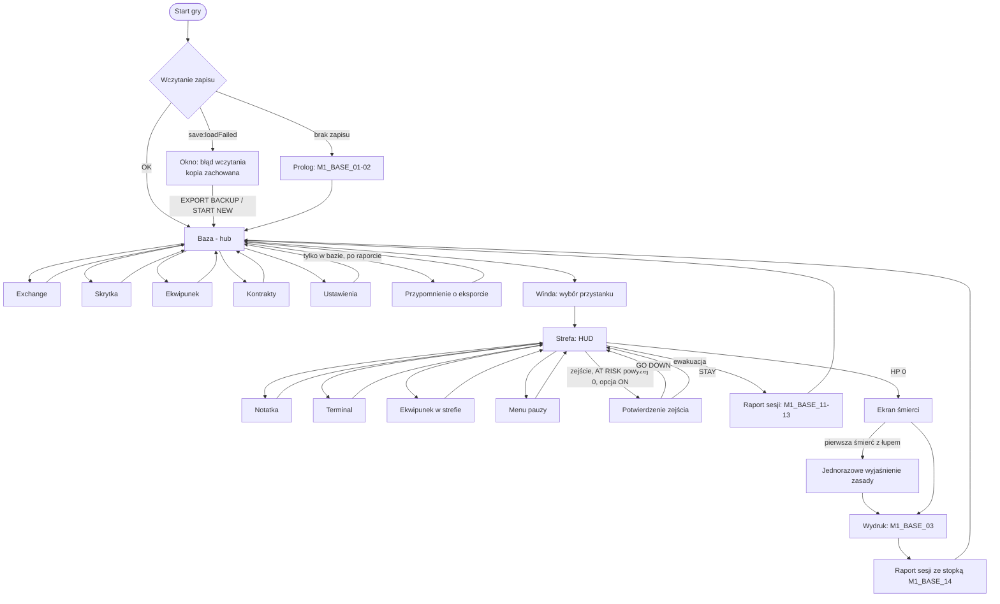

# UI M1: HUD, ekrany, śmierć, nauka gry (PROG / UI i Menu)

Autor: [GRA][PROG] UI i Menu, 25.10.2026. **Status: PROJEKT do uzgodnienia** (Mechaniki, Silnik, Gameplay, GRAF, Dialogi i Lore, QA), potem akceptacja Game Directora. To tylko projekt, bez zmian w `src/`.

**Aktualizacja 25.10.2026 ok. 21:45:** dopisane §11–§16 (elementy UI z `mechaniki-m1.md` v0.5, ustalenia z Mechanikami, pomiary i limity tekstu, S7, ID tekstów, pytania). Tam, gdzie się różnią, §11–§12 mają pierwszeństwo przed §3–§7. Starsze sekcje mają odsyłacze „→ §12”.

**Źródła (przeczytane):**
- `wizja-gry.md`, `plan-produkcji.md`, `zespol.md` (z decyzjami GD z 25.10 ok. 21:04);
- `design/mechaniki-m1.md` v0.4 (zwłaszcza 1.11, 1.16, 2.1–2.17);
- `design/zagadki-m1/power-lines-line1.md` (§5–7, §12–13);
- `fabula/teksty-m1-en.md` (zatwierdzone ID), `fabula/zakres-m1.md`;
- `graf/styl-ascii.md` v1.2 (zatwierdzony) + §11 (okno terminala, zatwierdzone);
- `qa/plan-testow-m1.md` (R1–R17, telemetria §4.3, checklisty §4.4);
- `prog/sterowanie.md` (zasady zaakceptowane przez GD), `prog/m0-status.md`, `prog/kontrakty-m1.md`;
- kod: `prog/game/src/ui/*`, `core/events.ts`, `core/loop.ts` (README), `save/api.ts`, `save/storage-env.ts`, `data/save-reminder.ts`, `data/style.ts`, `combat/combat.ts` (`getCombatHud`).

**Oznaczenia:**
- **[D: źródło]** = fakt z dokumentu. **[Z]** = założenie UI (nie ma go w dokumentach, do potwierdzenia). **[?Mx] / [?Sx] / …** = pytanie z sekcji 9.
- Teksty w grze: **tylko po ID**. Gdzie ID jeszcze nie ma, podaję **nowe ID + sens po polsku**. Etykiety w cudzysłowie to *robocze*, ostateczną treść daje Dialogi i Lore (A2).

---

## 0. Zasady wiążące (z `sterowanie.md` i decyzji GD)
1. Wszystkie etykiety w grze po angielsku, pobierane po ID [D: GD, sterowanie].
2. Styl znakowy ASCII: znaki i proste ramki, **bez ikon graficznych** [D: GD]. Kolory, glify i font **tylko z `src/data/style.ts`**; nowe wartości oznaczone „do akceptacji GRAF” [D: zespol.md].
3. Cele dotyku min. **48×48 px CSS** (≈ dp), odstęp ≥ 8 px [D: sterowanie §2]. Komórka mapy min. 20 px, glif min. 16 px, nakładki min. 12 px z obrysem [D: mech 1.16/1.17].
4. Każda informacja ma drugi sygnał poza kolorem [D: GRAF §1]. „Reduce motion” wyłącza miganie, znaczenie zostaje [D: GRAF §6].
5. Dotyk + klawiatura dla każdej akcji. Kontrolki dotykowe widoczne po pierwszym dotyku, ukrywane po użyciu klawiatury [D: sterowanie §7].
6. Pauzy [D: mech 2.14]: notatki **zawsze**; terminal **tylko poza walką** (inaczej `M1_SYS_04`); ekwipunek pauzuje **tylko poza walką**, w walce świat działa, mapa przyciemniona. Menu pauzy i auto-pauza: wznowienie świadome (RESUME/Esc/P/Enter, **nie Spacja**) + odliczanie 1,0 s [D: mech 1.11].
7. „Poza walką” = żaden wróg nie jest w CHASE/ATTACK [D: mech 2.14].
8. Decyzje GD (25.10, 21:04) [D: zespol.md]:
   - ekran śmierci i podsumowanie pokazują **przyczynę śmierci** (kto zabił, ostatnie trafienia); **podsumowania zawsze prawdziwe**: liczby z logu gry, bez zaokrągleń i upiększeń;
   - **potwierdzenie przy zejściu `>`**, gdy `AT RISK` > 0, z przełącznikiem w ustawieniach;
   - **znacznik „can be lost”** na ryzykownych przedmiotach;
   - **jednorazowe wyjaśnienie zasady utraty** przy pierwszej śmierci z łupem (zapamiętane);
   - trudność bez zmian (Z-GD2): wszystko powyżej to wyłącznie informacja.

## 1. Architektura UI (DOM nad canvasem)
Zgodnie z kodem M0 [D: `ui/overlay.ts`, README]: canvas rysuje świat i efekty walki (`!`, `x`, liczby obrażeń – Gameplay), DOM w `src/ui/` rysuje HUD, kontrolki, okna. Proponowany podział M1 [Z, nazwy plików robocze]:

| Moduł (`src/ui/`) | Zawartość | Stan M0 |
|---|---|---|
| `hud.ts` | HP + wiersze M1 (`AT RISK`, `BAG`, status windy) | wiersze `resource / at-risk / backpack` już są jako ukryte haki |
| `touch-controls.ts` | joystick, ATK, USE, sk1–3, `[+]` | haki `reserved.use / skills / medPatch` już są |
| `messages.ts` (nowy) | kolejka komunikatów HUD i podpowiedzi nauki | dziś `ui.toast()` (1,6 s, 1 linia) |
| `screens/` (nowy) | stos ekranów: baza, Exchange, skrytka, ekwipunek, kontrakty, winda, raport, śmierć, ustawienia | – |
| `terminal.ts` (nowy) | okno Power Lines (sekcja 5) | – |
| `modal.ts` (nowy) | okna potwierdzeń (zejście `>`, start od nowa, eksport, błąd wczytania) | – |
| `text-window.ts` | notatki (NEXT/CLOSE) | gotowe |

**Stos ekranów [Z]:** jeden menedżer `screens.push/pop`. Zasady: Esc / przycisk `[X] BACK` (48×48, prawy górny róg okna) zawsze zdejmuje górny ekran; ekran sam decyduje, czy pauzuje świat (tabela w 3.0). Klawisze użyte do zamknięcia ekranu są blokowane do puszczenia (`onKeyConsumed` jak w M0), żeby Esc/Enter/Spacja nie „przeciekły” do gry [D: kod M0].

**Powody pauzy:** pętla zna dziś `'menu' | 'text' | 'auto'` [D: `core/events.ts`]. M1 potrzebuje odróżnić terminal, ekwipunek poza walką i okno potwierdzenia (inne zasady wznowienia). Propozycja: dodać `'terminal' | 'inventory' | 'confirm'` albo jeden `'screen'` z polem `screenId` [?S1].

**Prostokąty UI a kamera:** każdy element HUD/kontrolek zgłasza swój prostokąt, a kamera trzyma `@` i jego najbliższe otoczenie poza nimi (rozszerzenie `CAMERA_SAFE_MARGINS` [D: `data/camera.ts`]). Ten sam zbiór prostokątów idzie do telemetrii QA („wróg pod UI”, C5) [?S2].

---

## 2. HUD M1 (w strefie)

### 2.1 Elementy i dane
| Element | Wygląd (ASCII) | Dane (źródło) | Zachowanie |
|---|---|---|---|
| HP | `HP [########--] 80/100` | `getCombatHud(state).hp/maxHp` [D: kod] | jak M0: kolor wg progu + długość paska + liczba; błysk przy obrażeniach |
| AT RISK | `AT RISK: 412 cr` | suma wartości sprzedaży plecaka + założonego sprzętu poza Issue + kredytów ze strefy [D: mech 2.1, 2.17 pkt 11] | aktualizacja przy każdej zmianie; krótkie podświetlenie, gdy rośnie. Liczba zawsze dokładna (bez „1.2k”) [D: GD]. Jednostka „cr” po ID [?L] |
| Plecak | `BAG 9/12` | zajęte sloty / `BAG_SLOTS` [D: mech 2.16] | przy 12/12 kolor ostrzeżenia + słowo `FULL` (drugi sygnał). **Tap = otwiera ekwipunek** (pole 48 px wys.) [Z] |
| Med-Patch | przycisk `[+]` + licznik `4` | sztuki w plecaku, limit 6 [D: mech 2.13] | przy 0 przygaszony + `0`; w trakcie odnowienia (4 s) cyfry sekund `3.2` zamiast licznika na zmianę z licznikiem [?G3]; na PC tylko w HUD: `[+] 4  Q` |
| Sloty sk1–3 | `[1]` `[2]` `[3]` + nazwa skrótem pod spodem tylko na PC | `skillId` w slocie, odnowienie, odblokowanie [D: mech 2.5] | gotowa: jasna ramka; odnowienie: pasek znakowy w przycisku `[##--]` + sekundy `3.2` (1 miejsce po przecinku, liczone z ticków); zablokowana (przed odblokowaniem): `[--]` przygaszona, tap pokazuje komunikat, że jeszcze niedostępna [?L] |
| USE | `USE` nad ATK | obiekt w zasięgu (sprzęt, `%`, `&`, `<`, notatka) [D: mech 1.16 pkt 6] | widoczny tylko przy obiekcie; pod etykietą krótka nazwa celu (np. nazwa przedmiotu po ID) [Z]. Przytrzymanie przy szybie: pasek postępu w przycisku `[####----]` 1,5 s, przerwanie = pasek znika + krótki komunikat [?L] |
| Pauza | `[||]` prawy górny róg | – | bez zmian z M0 |
| Status windy | `LIFT 7s` → `LIFT HERE 10s` | dojazd 5/7/9 s, okno 10 s, ponowne wezwanie po 15 s [D: mech 2.9] | wiersz pod `BAG`, tylko od wezwania do końca okna; sekundy całkowite w dół (ceil) – to licznik, nie podsumowanie [Z] |
| Komunikaty HUD | 1 linia, środek u góry, pod paskiem bezpiecznym | `M1_SYS_04/05/06`, `M1_BASE_06/07`, `M1_SKILL_UNLOCK/LEVELUP`, `M1_BASE_09` | kolejka (sekcja 2.4) |
| Zapowiedź ciosu / ALERT | na canvasie (Gameplay): żółty `!` + odwrócona komórka + `x` na `#4A1240`; szary `!` 300 ms [D: GRAF §9] | – | UI **nie rysuje** tych sygnałów, tylko gwarantuje, że nie są zasłonięte (1. prostokąty UI); pływające liczby obrażeń mogą wychodzić poza komórkę [D: mech 1.17] |

Strzałka do zwłok: kod istnieje, wyłączona flagą `CORPSE_ARROW_ENABLED` do M2 [D: mech 2.7] – w HUD zarezerwowany brzeg ekranu, nic nie rysujemy w M1.

### 2.2 Telefon poziomo (główna, np. 667×375)
```
+------------------------------------------------------------------+
| HP [########--] 80/100                                    [||]   |
| AT RISK: 412 cr                                                  |
| BAG 9/12   LIFT 7s                                               |
|            .  .  #  #  #  .  .  .  .     The lift is loud. ...   | <- komunikat (środek, 1 linia)
|            .  .  @  .  .  ,  .  d  .                             |
|            .  .  .  .  .  #  .  !  .                             |
|                                                 [+]4             |
|   (joystick pływający,                    [1]  [2]              |
|    lewa połowa)                        [3]       [ USE ]         |
|                                                 (  ATK  )        |
+------------------------------------------------------------------+
```
- Prawy kciuk: ATK 72 px (prawy dolny), USE 56×48 nad ATK [D: kod M0], sk1–3 w łuku po lewej i nad ATK (48 px, odstęp ≥ 8 px), `[+]` nad slotami [D: sterowanie M1]. Odległość `[+]` od najbliższego slotu ≥ 16 px, żeby pomyłka patch/umiejętność była rzadka (QA C4: ≤ 5%) [Z].
- HUD lewy górny: 3 wiersze × ok. 20 px = ok. 64 px + margines. Kamera trzyma `@` poza tym pasem (dziś `CAMERA_SAFE_TOP_ROWS = 3`).
- Leworęczny: lustrzane odbicie dolnej części (jak M0, `?lefty=1` → ustawienie).

### 2.3 Telefon pionowo (np. 360×640) i PC
**Pionowo:** HUD jak wyżej (3 wiersze na górze), mapa 17×21 w środku, kontrolki w dolnych ~40% [D: sterowanie §5]. Łuk sk1–3 + `[+]` mieści się nad ATK, bo szerokość prawej połowy to 180 px: ATK 72 + łuk 2 × 48 + odstępy [Z, do zmierzenia w e2e jak w M0].
```
+------------------------------+
| HP [######----] 61/100 [||]  |
| AT RISK: 412 cr              |
| BAG 9/12                     |
|   mapa 17×21                 |
|        . . @ . d .           |
|                              |
|                  [+]4        |
|  (joystick)    [1] [2]       |
|              [3]   [USE]     |
|                   ( ATK )    |
+------------------------------+
```
**PC (1280×720):** bez kontrolek dotykowych. Jedna kolumna HUD lewy górny + pasek umiejętności na dole na środku (tylko podgląd stanu, klikalny myszą):
```
HP [########--] 80/100                                              [||] Esc
AT RISK: 412 cr
BAG 9/12  (I)
                              ... mapa ...
              [1 Dash 3.2]  [2 Shock Pulse]  [3 Buddy Drone --]  [+] 4 Q    E: USE
```
Nazwy umiejętności po ID `M1_SKILL_0x_NAME` [D: teksty §10.2].

### 2.4 Komunikaty HUD (kolejka)
- 1 linia, środek u góry, pod pasem HUD. Min. 16 px, ciemna podkładka (`hudBg`). Na telefonie poziomo nigdy w dolnej połowie (kciuki).
- Priorytety [Z]: (1) ewakuacja (`M1_BASE_06/07`, `M1_SYS_05`), (2) blokady akcji (`M1_SYS_04`, `M1_SYS_06`), (3) postęp (`M1_SKILL_UNLOCK`, `M1_BASE_09`), (4) podpowiedzi nauki (sekcja 7). Wyższy priorytet przerywa niższy. Ten sam komunikat powtórzony w ciągu 3 s tylko odświeża czas (bez migania) [Z].
- Czas: 2,5 s + 0,05 s na znak, maks. 6 s [Z]. Komunikaty o windzie trzymane do zmiany stanu windy.
- `M1_SYS_06` „Bag full.”: przy każdej nieudanej próbie, ale maks. raz na 3 s [Z].
- Uwaga: opis `M1_SYS_04` w tekstach mówi „terminal **lub ekwipunek** w walce”, a mech 2.14 pozwala otwierać ekwipunek w walce bez pauzy. UI używa `M1_SYS_04` **tylko dla terminala** [?M1, ?L].

### 2.5 Niski ekran (< 330 px wysokości, np. 568×320 lub Safari poziomo)
Znane ograniczenie: przy glifie 16 px nie mieści się 17 wierszy [D: m0-status pkt 5].
- HUD zwija się do **1 wiersza** [Z]: `HP 80/100 [#####-] · RISK 412 · BAG 9/12` (pasek HP 6 znaków). Status windy zastępuje `BAG` na czas ewakuacji.
- Kontrolki zostają 48 px (nie zmniejszamy celów dotyku); ATK z 72 px → 64 px, USE nad ATK zmienia się w USE **na lewo** od ATK, żeby nie zabierać wysokości [Z].
- Mapa: komórka nie schodzi poniżej 20 px; jeśli 17 wierszy się nie mieści, pokazujemy tyle, ile wejdzie, i **zgłaszamy to Mechanikom** (minimum widoku 31×17 [D: mech 1.10] vs zasięg wykrycia 7–8 [D: mech 2.11]) [?M2].
- Proponowany próg: wysokość viewportu < 300 px w poziomie → jednorazowa podpowiedź „obróć telefon pionowo daje większy widok” (ID `M1_UI_ROTATE_HINT`) [Z].

### 2.6 Ekwipunek w strefie (skrót)
Otwiera: tap `BAG 9/12` / klawisz **I** (PC) [Z: klawisz do potwierdzenia ?M3]. Poza walką pauza; **w walce bez pauzy**, mapa przyciemniona [D: mech 2.14] – nad oknem pasek ostrzeżenia `M1_UI_INV_COMBAT` (sens: „walka trwa, gra się nie zatrzymała”), HP widoczne cały czas, okno zajmuje tylko połowę ekranu przeciwną do `@` [Z]. Treść jak ekran ekwipunku w bazie (3.4), bez skrytki.

---

## 3. Ekrany M1

### 3.0 Przegląd i przepływ
| Ekran | Gdzie | Pauzuje świat? | Zamknięcie |
|---|---|---|---|
| Baza (hub) | po ewakuacji / wydruku | w bazie nie ma wrogów → pauza nie jest potrzebna [Z, ?M4] | – |
| Exchange (sklep) | baza, automat `$` | nie dotyczy (baza) | Esc / BACK |
| Skrytka (Hunter Locker) | baza, `≡` | nie dotyczy | Esc / BACK |
| Ekwipunek | baza i strefa | strefa: tylko poza walką | Esc / I / BACK |
| Kontrakty (tablica) | baza, terminal BASE | nie dotyczy | Esc / BACK |
| Winda: wyjazd (wybór przystanku) | baza, `>` wyjście | nie dotyczy | Esc / BACK |
| Raport sesji | po ewakuacji i po wydruku | nie dotyczy | CONTINUE |
| Ekran śmierci | strefa, po 0,5 s zatrzymania | świat stoi [D: mech 1.8] | NEXT (`M1_DEATH_BTN`): tap / Enter po 1500 ms, auto po 5000 ms (§11.10) |
| Potwierdzenie zejścia `>` | strefa | [?M5] | GO DOWN / STAY |
| Terminal Power Lines | strefa, `&` | tak, otwarcie tylko poza walką | EXIT / Esc / E |
| Notatka | strefa | zawsze | CLOSE / Esc |
| Ustawienia | menu pauzy i baza | jak menu pauzy | Esc / BACK |



**Wspólne sterowanie ekranów [Z]:**
- Dotyk: listy przewijane palcem (wyjątek od zasady „bez przewijania” – dotyczy tylko list, nie siatki terminala), wiersz listy min. 48 px, tap = zaznacz i pokaż szczegóły, przycisk akcji (BUY / SELL / EQUIP …) w stałym miejscu na dole panelu szczegółów, `[X] BACK` prawy górny róg.
- Klawiatura: strzałki / WASD = ruch zaznaczenia, Tab = przełącz kolumnę (np. plecak ↔ skrytka), **Enter** = akcja główna, **Spacja nie potwierdza** (to atak, ten sam powód co przy pauzie), Esc = wstecz. Skróty literowe pokazane w etykietach przycisków (np. `SELL (X)`).
- Akcje nieodwracalne (sprzedaż Grid-Grade, start od nowa) wymagają drugiego potwierdzenia [Z].
- Etykiety ekranów i przycisków: nowe ID `M1_UI_*` (sekcja 8).

### 3.1 Baza (hub)
> **→ §12.4 / §11.11: baza to menu-hub, nie chodzona mapa; tablica kontraktów i LIFT widoczne od razu, bez ticków i auto-pauzy. „Forma” i pasek skrótów poniżej są nieaktualne.**
- **Cel:** przygotowanie do wyprawy (30–90 s [D: mech 2.1]), decyzja „co zabrać” i widoczny postęp (światła nad bazą, sieć).
- **Zawartość:** Reprint Vat `Ω`, Exchange `$`, skrytka `≡`, terminal BASE (kontrakty), wyjście `>` do windy [D: GRAF §4 Baza, teksty `M1_LOC_BASE`]; ulepszenie „Lights Above the Base” widoczne na mapie (żółte `-` `|`) [D: GRAF, mech 2.15]; mapa sektora z zapalonymi fragmentami (`▓` / `·`) [D: GRAF §4].
- **Forma [Z, ?M4]:** baza jako **mały ekran ASCII**, po którym gracz chodzi tymi samymi kontrolkami; USE przy obiekcie otwiera ekran. Dodatkowo pasek skrótów na dole (tap/klawisz), żeby mikro-sesja (15–45 s [D: mech 2.2]) nie wymagała chodzenia. Jeśli Mechaniki/LD wolą bazę jako menu, pasek skrótów zostaje jedynym wejściem – reszta projektu bez zmian.
- **Panel stanu bazy (górny wiersz):** kredyty na koncie (bezpieczne), `GRID 30%`, Med-Patche w plecaku, `AT RISK on departure: {cr}` (wartość założonego sprzętu poza Issue + plecaka) [Z].
```
Telefon poziomo                                                  PC
+------------------------------------------------------------+   CREDITS 312 cr   GRID 30%   [+] 2/6   RISK ON DEPARTURE 140 cr
| CREDITS 312   GRID 30%   [+]2/6   RISK 140            [||] |
|                                                            |           #################
|        #################                                   |           #  Ω     &      #
|        #  Ω     &      #        (mapa bazy)                |           #     @        >#
|        #     @        >#                                  |           #  $     ≡      #
|        #  $     ≡      #                                  |           #################
|        #################                       [ USE ]    |
| [EXCHANGE] [LOCKER] [GEAR] [ORDERS] [LIFT]    (  ATK  )   |   1 EXCHANGE  2 LOCKER  3 GEAR(I)  4 ORDERS  5 LIFT
+------------------------------------------------------------+
```
- **Sterowanie:** ruch jak w strefie; USE (E) przy obiekcie; pasek skrótów: tap albo klawisze 1–5 [Z] (w bazie nie ma umiejętności, więc 1–3 nie kolidują – do potwierdzenia ?M4). ATK w bazie ukryty [Z].
- **Stany:** pierwszy wydruk (Prolog) – pokazuje `M1_BASE_01`, `M1_BASE_02` w oknie tekstu, potem tylko obiekty potrzebne do wyjścia są podświetlone (sekcja 7). Brak kredytów na Med-Patch – przycisk w Exchange nieaktywny + `M1_EXCH_04`.

### 3.2 Exchange (sklep-automat)
- **Cel:** kupno (Med-Patch, ewentualnie sprzęt), sprzedaż łupu, kontrakty Exchange (Deliver, Sell) [D: mech 2.4, 2.12].
- **Dane:** kredyty konta; oferta (lista towarów **nieznana** poza Med-Patchem 25 kr [D: mech 2.13] [?B1]); ceny sprzedaży: Scrap 2, Copper 5, sprzęt 10/40/150 × (1 + 0,5·(poziom − 1)) (R) [D: mech 2.12]; Exchange **nie kupuje** Issue ani Med-Patchy [D: mech 2.12]; aktywny kontrakt Exchange (`M1_CONTR_04/05`).
- **Teksty:** `M1_EXCH_01` (wejście), `_02` (kupno), `_03` (sprzedaż, `{credits}`), `_04` (brak kredytów), `_05` (pełny plecak), `_06` (wyjście).
```
Telefon poziomo
+--------------------------------------------------------------------+
| EXCHANGE                      CREDITS 312 cr                 [X]   |
| "EXCHANGE ONLINE. Supply must keep flowing..."  (M1_EXCH_01)       |
| [ BUY ]  [ SELL ]   ORDER: Sell one Tuned item  +50 cr             |
|--------------------------------------+-----------------------------|
| > [+] Med-Patch          25 cr  2/6  | Med-Patch                   |
|   /  ◆ Rail Pistol       60 cr  RISK | Heal: 40 HP · Time: 2 s ... |
|   [  Plated Suit         15 cr  RISK | CAN BE LOST (in your bag)   |
|                                      |        [ BUY  25 cr ]       |
+--------------------------------------+-----------------------------+
PC: ta sama siatka; kolumny: lista | szczegóły | (w trybie SELL) porównanie z założonym.
```
- **SELL:** lista = plecak + (osobna zakładka) skrytka [Z]. Wiersz: glif slotu w kolorze rzadkości + znacznik `◆`/`◆◆` [D: GRAF §4], nazwa, cena; przedmioty spełniające kontrakt Exchange mają dopisek `ORDER` [Z]. Sprzedaż przedmiotu Grid-Grade albo założonego → drugie potwierdzenie.
- **Znacznik „can be lost”:** przy BUY obok każdego towaru, który trafi do plecaka (wszystko poza Issue), krótki tag `RISK` i w szczegółach linia `M1_UI_CAN_BE_LOST` [D: GD, Z: forma tagu ?G1].
- **Sterowanie:** dotyk – tap wiersz, przycisk akcji; klawiatura – ↑↓ wybór, ←→ / Tab przełącza BUY/SELL, Enter akcja, Esc wyjście. Licznik ilości dla materiałów (Deliver): `-` / `+` 48 px, klawiatura ←→ [Z].
- **Stany puste/błędy:** brak kredytów → przycisk nieaktywny + `M1_EXCH_04`; Med-Patch przy 6/6 → nieaktywny + `M1_UI_PATCH_LIMIT` (sens: „limit 6”); pełny plecak → `M1_EXCH_05`; próba sprzedaży Med-Patcha/Issue → wiersz bez ceny, tag `CAN'T SELL` (`M1_UI_CANT_SELL`); pusta zakładka SELL → `M1_UI_EMPTY_SELL`.

### 3.3 Skrytka (Hunter Locker)
- **Cel:** bezpieczne przechowanie sprzętu; decyzja „co zabrać” [D: mech 2.3].
- **Dane:** 30 slotów (40 po ulepszeniu) [D: mech 2.16]; plecak 12; założone 4 sloty; opis szafki `M1_ITEM_LOCKER`, przedmiot #46 `M1_ITEM_46` [D: teksty §7.4].
```
+--------------------------------------------------------------------+
| LOCKER  (SAFE)  17/30                 BAG (CAN BE LOST) 9/12   [X] |
|-------------------------------+-------------------------------------|
| / ◆◆ Grid-Grade Baton         | > [ Plated Suit            RISK    |
| " ◆  Quick Module             |   : Scrap x18              RISK    |
| (    Bent Key Tag             |   + Med-Patch x2           RISK    |
| ...                           |   ...                              |
|-------------------------------+-------------------------------------|
|  [ TAKE > ]   [ < STORE ]   [ EQUIP ]          szczegóły zaznaczonego |
+--------------------------------------------------------------------+
```
- Lewa kolumna nagłówek `SAFE` (`M1_UI_SAFE`), prawa `CAN BE LOST` – zasada utraty widoczna w samym układzie [D: GD znacznik, Z: forma].
- **Sterowanie:** dotyk – tap przedmiot, przycisk TAKE/STORE; klawiatura – Tab kolumna, ↑↓ wybór, Enter = przenieś na drugą stronę, `F` = EQUIP (Q i E są zajęte przez Med-Patch i USE) [Z, ?M3]. Bez przeciągania (precyzja na telefonie) [Z].
- **Stany:** skrytka pełna → `M1_UI_LOCKER_FULL`; plecak pełny → `M1_EXCH_05`-podobny komunikat, ale z ID `M1_UI_BAG_FULL_BASE` (`M1_SYS_06` „Bag full.” też pasuje – decyzja Lore); pusta skrytka → `M1_UI_EMPTY_LOCKER`.

### 3.4 Ekwipunek (założony sprzęt + plecak)
- **Cel:** zakładanie/zdejmowanie, porównanie, wyrzucanie; podgląd statystyk.
- **Dane:** 4 sloty (Weapon / Armor / Module / Tool, opisy `M1_ITEM_SLOT_*`), plecak 12, statystyki postaci (HP max, DPS broni, pancerz i DR „−23%” [D: mech 2.11]), afiksy (`M1_AFFIX_01–12` – nazwy, liczby z Balansu [D: teksty §7.3]), rzadkości `M1_RARITY_1–3`, wartość sprzedaży (wliczana do `AT RISK`).
```
Telefon poziomo
+--------------------------------------------------------------------+
| GEAR                        AT RISK: 412 cr                   [X]  |
| WEAPON  / ◆ Quick Rail Pistol   RISK |  Quick Rail Pistol  ◆ Tuned  |
| ARMOR   [   Issue Suit          ISSUE|  Damage 8-11 · Range 6       |
| MODULE  "   (empty)                  |  Quick: +8% attack speed     |
| TOOL    (   (empty)                  |  vs equipped: +4.5 DPS       |
|--------------------------------------|  Value 60 cr · CAN BE LOST   |
| BAG 9/12                             |                              |
| [:x18][+x2][/ ][[ ][§ ][  ][  ]...   |  [ EQUIP ] [ DROP ] (zone)   |
+--------------------------------------------------------------------+
PC: siatka plecaka 6×2, szczegóły po prawej, statystyki postaci pod slotami.
```
- **Znaczniki:** każdy założony przedmiot poza Issue i każdy w plecaku ma tag `RISK`; Issue ma tag `ISSUE` (`M1_UI_ISSUE_TAG`, opis `M1_GEAR_ISSUE`) [D: mech 2.3]. Data Core `§` – tag `RISK` + `ORDER`.
- **Porównanie:** różnica z założonym (`+4.5 DPS`, `−6% DR`) z prawdziwych liczb, znak `+`/`−` i słowo (drugi sygnał) [Z]. DR pokazujemy z 1 miejscem po przecinku, jeśli wartość nie jest całkowita [Z; „bez zaokrągleń” GD dotyczy podsumowań – ?M6].
- **DROP:** tylko w strefie (upuszczony leży do końca wyprawy [D: mech 2.12]); w bazie zamiast DROP jest STORE/SELL.
- **Sterowanie:** dotyk – tap slot/komórkę, przycisk akcji; klawiatura – strzałki, Tab (sloty ↔ plecak), Enter = EQUIP/UNEQUIP, `X` = DROP z potwierdzeniem przy r2/r3 [Z], I/Esc = zamknij.
- **Stany:** pusty slot `(empty)` (`M1_UI_EMPTY_SLOT`); zdjęcie przy pełnym plecaku → `M1_SYS_06`; w walce → pasek `M1_UI_INV_COMBAT` (2.6).

### 3.5 Kontrakty (tablica BASE + Exchange)
- **Cel:** wybór i śledzenie kontraktów krótkich sesji [D: mech 2.4].
- **Dane (z kodu LUZ / Pracownik 2):** `ContractsState.base` (2 sloty), `exchange` (1 slot, jeszcze nie w module), dla każdego: `textId` (`M1_CONTR_01–05` – tytuł + zdanie tła), głębokość, nagroda `{credits, copper, medPatches}` + fragment sieci, postęp (`contract:progress`), flaga retune [D: `kontrakty-m1.md`]. Kontrakty BASE są aktywne w **każdej** wyprawie (nie „przyjmuje się” ich ręcznie) [D: mech 2.4; kontrakty A4].
```
+--------------------------------------------------------------------+
| ORDERS                                                        [X]  |
| BASE  Restore Relay            depth 1   40 cr + GRID +10%         |
|       "This relay is a small part of the line..."                  |
|       Progress: terminal not solved                                |
| BASE  Clear the Path to the Lift  depth 1   1 Med-Patch            |
|       Progress: 2/6                                                |
| EXCH  Sell One Tuned Item      base      +50 cr                    |
|-------------------------------------------------------------------- |
| Orders end when you are back in the lift. If you die, they reset.  |  <- M1_UI_ORDERS_RULE
+--------------------------------------------------------------------+
```
- Placeholdery w tekstach `[RELAY_ID_TBD]`, `[N_TBD]`, `[MATERIAL_TBD]`, `[RARITY_TBD]`, `[REWARD_TBD]` UI wypełnia danymi z kontraktu – potrzebne tokeny `{…}` zamiast `[…_TBD]` [?L].
- **W strefie:** aktywne kontrakty w menu pauzy (sekcja „ORDERS”) i jako 1 linia postępu w komunikacie przy zmianie (`contract:progress`) [Z]. Ukończenie celu (`objectiveMet`) → komunikat `M1_UI_ORDER_MET` (sens: „cel wykonany, wróć windą”) [D: mech 2.4 – kończy się dopiero po ewakuacji].
- **Stany:** brak kontraktu w slocie (tylko przejściowo) → `M1_UI_NO_ORDER`; nowy kontrakt po powrocie → `M1_BASE_10`; nieudany po śmierci → w raporcie, kontrakt zostaje na tablicy z wyzerowanym postępem [D: kontrakty A4].

### 3.6 Winda: wyjazd (wybór przystanku)
- **Cel:** wyjazd do strefy; wybór głębokości z odblokowanych przystanków [D: mech 2.9].
- **Dane:** przystanki (głęb. 1 zawsze, 2 i 3 po pierwszym terminalu na tej głębokości), `AT RISK` przy wyjeździe, Med-Patche po uzupełnieniu Issue (do 2, po ulepszeniu 3) [D: mech 2.3], kontrakty dostępne na danej głębokości.
```
| LIFT                                                         [X] |
| > DEPTH 1  Outskirts      orders: 2                              |
|   DEPTH 2  Solar Fields   orders: 0                              |
|   DEPTH 3  locked  (restore a line on depth 3)                   |
| You take: [+] 2  ·  AT RISK: 140 cr (CAN BE LOST)                |
|                         [ GO ]                                   |
```
- Teksty: nazwy głębokości z `M1_LOC_D1–3` (nazwy) – potrzebne krótkie nazwy osobno [?L]; `M1_GEAR_ISSUE_TOPUP` przy uzupełnieniu.
- Sterowanie: ↑↓, Enter = GO, Esc. Zablokowany przystanek – szary, tap pokazuje warunek.

### 3.7 Raport sesji (SESSION REPORT)
- **Cel:** widoczny ślad każdej sesji (filar 6), prawdziwe liczby [D: wizja, GD].
- **Kiedy:** po ewakuacji (`M1_BASE_05` → raport → stopka `M1_BASE_13`) i po wydruku po śmierci (`M1_BASE_03` → raport → stopka `M1_BASE_14`) [D: mech 2.7, 2.9].
- **Dane (wszystkie z logu sesji, sekcja 4.3):**
  - z `M1_BASE_12`: czas w strefie `{time}`, najgłębszy poziom `{depth}`, przedmioty przywiezione `{items_in}`, zostawione/utracone `{items_lost}`, kredyty `{credits}`, sieć `{grid_pct}%`;
  - dodatkowo [D: GD, mech 2.2]: **przyczyna śmierci** (tylko po śmierci, jak na ekranie śmierci, skrót), strata = **dokładnie ostatni `AT RISK`** [D: mech 2.17 pkt 5], kontrakty ukończone z nagrodami / nieudane (`hadProgress`), zabici wrogowie w sesji (różnica `getCombatHud().kills` od startu sesji [D: kod Gameplay; ?P3]), co najmniej 1 trwała zmiana: fragment sieci, biegłość (`M1_SKILL_LEVELUP`, postęp np. `Dash 23/40`), nowa umiejętność, przeczytane notatki, ulepszenie bazy.
- **Formatowanie bez zaokrągleń:** czas `m:ss` liczony z ticków (pełne sekundy, ułamek obcięty i to jest jedyna konwersja, opisana w pomocy [?M6]); kredyty i obrażenia jako liczby całkowite z gry; procent sieci = suma fragmentów (wielokrotności 10/20, więc całkowity).
```
+--------------------------------------------------------------------+
| SESSION REPORT — HUNTER 47                         (M1_BASE_11)    |
| Time in zone        7:42                                           |
| Deepest level       2                                              |
| Items brought back  9                                              |
| Items left in zone  0                                              |
| Credits             +186                                           |
| Grid restored       30%   (+10%)                                   |
| Enemies destroyed   14                                             |
| Orders              Restore Relay  DONE  +40 cr                    |
| Progress            Dash 23/40 · New note: Shift note              |
| All data is saved. The grid is a little less dark.  (M1_BASE_13)   |
|                          [ CONTINUE ]                              |
+--------------------------------------------------------------------+
Po śmierci zamiast "Items brought back" wiersze: Killed by  Curfew Guard (h) · Lost  412 cr (9 items), stopka M1_BASE_14.
```
- `M1_BASE_12` jest jednym ciągiem z separatorami `·`; do układu w wierszach potrzebne osobne ID na etykiety (`M1_BASE_12a–f` albo `M1_UI_REP_*`) [?L].
- **Uwaga:** ten CONTINUE dotyczy **tylko raportu sesji** (`M1_UI_BTN_CONTINUE`), nie ekranu śmierci – tam jest NEXT (§11.10). Ujednolicenie nazwy do decyzji Lore/Producenta (§17.7).
- **Sterowanie:** CONTINUE (tap, Enter); Spacja nie zamyka [Z]. CONTINUE aktywny po 0,8 s (ochrona przed przypadkowym tapnięciem) [Z].
- **Błędy:** brak danych w logu (np. zapis sprzed M1) → wiersz pominięty, nigdy szacowany [D: GD].

### 3.8 Menu pauzy M1 i Ustawienia
- Pauza: `PAUSED`, RESUME, **ORDERS** (podgląd kontraktów), **SETTINGS**, sekcja zapisu (eksport/import jak w M0 – przeniesiona do SETTINGS > SAVE) [Z]. Bez „QUIT TO BASE” – powrót tylko windą albo śmierć [D: mech 2.9].
- Ustawienia [D: GRAF §6, GD]: rozmiar czcionki (3 stopnie), Reduce motion, wysoki kontrast, leworęczny, **Confirm going deeper: ON/OFF** (domyślnie ON) [D: GD], **Hints: ON/OFF** (sekcja 7) [Z], **Export reminders** (sekcja 6.3) [?S6], przyciski SAVE: EXPORT FILE / COPY CODE / IMPORT.
- Zapis ustawień: w zapisie gry (`meta`) albo osobnym kluczu localStorage [?S3].

---

## 4. Ekran śmierci (R2) i potwierdzenie zejścia

### 4.1 Przebieg
> **→ §11.10 / §12.6:** ręczne przejście: 1500 ms bez pominięcia, po 5000 ms samo. Linie `M1_DEATH_01/02`. Panel wyjaśnienia (`M1_RISK_04`) jest **po** wydruku, przed podsumowaniem (§11.9c).
1. HP ≤ 0 → świat stoi 0,5 s [D: mech 1.8]; zabójca podświetlony na mapie (np. ramka komórki w kolorze ostrzeżenia) [D: QA R2 propozycja; rysuje Gameplay, ?P2].
2. Ekran śmierci (pełnoekranowa nakładka, mapa przyciemniona, widoczne zwłoki `%` [D: mech 2.7]):
```
+--------------------------------------------------------------------+
|              Signal lost. Hunter 47 is down.  (M1_BASE_04)         |
|                                                                    |
|  KILLED BY   h  Curfew Guard            depth 2                    |
|  LAST HITS   h Curfew Guard   -17   swing                          |
|              d Panel Drone    -9                                   |
|              t Line Sentry    -12   shot (from 5 tiles)            |
|  LOST        412 cr   (9 items · equipped: Plated Suit)            |
|              Order failed: Recover the Data Core                   |
|                                                                    |
|                            [ NEXT ]                                |
+--------------------------------------------------------------------+
```
- **KILLED BY:** glif (w kolorze wroga) + nazwa po ID (`M1_ENEMY_01–04`, `M1_BOSS_01`) albo źródło nie-wroga (np. niebezpieczna ciecz `~`, jeśli zadaje obrażenia – ?M7). Kolejność ostatnich trafień: od ostatniego (zabójczego) w górę.
- **LAST HITS:** **3 ostatnie** trafienia z logu: źródło, obrażenia **po pancerzu** (to, co zabrało HP), typ ataku. Opcjonalnie dopisek `no warning` / ikona-tekst, jeśli trafienie nie miało zapowiedzi albo źródło było niewidoczne [D: QA R2, C5]. Liczby dokładne [D: GD].
- **LOST:** dokładnie `AT RISK` z chwili śmierci + liczba przedmiotów + założony sprzęt poza Issue + nieudany kontrakt (jeśli `hadProgress`) [D: mech 2.7, 2.17 pkt 5].
- **Teksty:** `M1_BASE_04` (nagłówek); nowe ID etykiet `M1_UI_DEATH_KILLED_BY`, `_LAST_HITS`, `_LOST`, `_ORDER_FAILED`, nazwy typów ataku (`M1_UI_ATK_*`) [?L]. Tekst nie może obiecywać odzysku (QA R1 – rozwiązane w `M1_BASE_03/14` [D: teksty]).
3. **NEXT** (`M1_DEATH_BTN`) – **nieaktualna wersja tego punktu usunięta; obowiązuje §11.10**: tylko tap i Enter, liczy się nowe naciśnięcie po 1500 ms, auto-przejście po 5000 ms, auto-pauza wstrzymuje oba zegary (`loop.activeMs()`). Spacja, J i ATK nie działają. Cel bez zmian: gracz ma czas przeczytać przyczynę.
4. **Pierwsza śmierć z łupem** (`AT RISK` > 0 w chwili śmierci i flaga `deathRuleShown` = false): przed wydrukiem okno z jednym wyjaśnieniem zasady (`M1_UI_DEATH_RULE`, sens: „przy śmierci tracisz wszystko, co niosłeś i miałeś założone, poza Issue; skrytka i postęp sieci zostają”) + OK. Flaga zapisywana **od razu** w zapisie (zamknięcie karty w tym momencie nie powtórzy okna, ale też go nie zgubi: flaga ustawiana dopiero po OK) [D: GD; Z: moment zapisu ?S4]. Treść zasady potwierdzają Mechaniki [?M9].
5. Wydruk `M1_BASE_03` (okno tekstu) → raport sesji ze stopką `M1_BASE_14` → baza.

### 4.2 Dane, które gra musi logować (wymagania dla Gameplay i Silnika)
**Log obrażeń gracza (bufor pierścieniowy, min. 5 ostatnich – QA chce 5 [D: QA §4.3 `death`], ekran pokazuje 3):**
| Pole | Opis |
|---|---|
| `tick` | tick trafienia |
| `sourceKind` | `enemy` / `boss` / `hazard` / `other` |
| `sourceType` | klucz typu (`panelDrone`, `curfewGuard`, `scrapper`, `lineSentry`, `railGuardian`, …) → glif z `ENEMY_GLYPHS`, nazwa po `nameId` |
| `sourceId` | id encji (żeby „KILLED BY” = ta sama encja co ostatnie trafienie) |
| `attack` | `melee` / `shot` / `swing` / `charge` (boss) |
| `rawDamage`, `damage` | przed i po pancerzu (wyświetlamy `damage`) |
| `hpAfter` | HP po trafieniu |
| `telegraphed` | czy była zapowiedź na polu gracza |
| `sourceVisible` | czy źródło było na ekranie i nie pod prostokątem UI w chwili startu zapowiedzi (QA C5) |
| `distance` | odległość źródła (dla strzałów) |

**Rekord śmierci (zapisywany w chwili śmierci, w zapisie gry, żeby przetrwał zamknięcie karty na ekranie śmierci):** `killer` (= źródło ostatniego trafienia), `lastHits[5]`, `depth`, `atRiskAtDeath` (ta sama funkcja co HUD, ten sam tick), `itemsLost[]` (id, slot, rzadkość, wartość), `equippedLost[]`, `contractsFailed[]` (`hadProgress`), `timeInZoneTicks`, `phase` (walka / ewakuacja / eksploracja – QA), wrogowie w promieniu 8.

**Log sesji (dla raportu, zerowany przy wyjeździe windą):** `startTick`, `depthMax`, `itemsIn`, `itemsLost`, `creditsDelta`, `gridPctBefore/After`, `killsAtStart` (różnica z `getCombatHud().kills`), kontrakty ukończone/nieudane, odblokowania, przyrost biegłości, przeczytane notatki (ID), `endReason` (`evac` / `death`).

Zasada: raport i ekran śmierci **czytają tylko z tych rekordów**, nic nie liczą „na oko” [D: GD]. Telemetria QA (`death`, `damage_taken`) korzysta z tego samego logu [D: QA §4.3].

### 4.3 Potwierdzenie zejścia `>` (decyzja GD)
> **→ §12.5 / §11.9a (wiąże):** okno po wejściu na `>` (bez USE), pauza, zerowanie wejść. STAY = gracz zostaje na `>`; okno ponownie dopiero po zejściu z pola i ponownym wejściu albo po USE na `>`. Wznowienie po STAY z odliczaniem 1,0 s tylko, gdy wróg jest w CHASE/ATTACK. Brama areny tak samo. Teksty `M1_RISK_01*`. Domyślny fokus STAY, Enter = przycisk z fokusem.
- **Kiedy:** gracz wchodzi na `>` (albo naciska USE przy `>` – zależnie od mechaniki zejścia [?M5]), `AT RISK` > 0 i ustawienie „Confirm going deeper” = ON [D: GD].
```
+------------------------------------------+
|  GO DEEPER?                              |
|  Depth 2 → 3                             |
|  AT RISK: 580 cr  (CAN BE LOST)          |
|  HP 61/100 · [+] 3 · BAG 11/12           |
|  [ STAY ]                [ GO DOWN ]     |
|  Turn off: SETTINGS > Confirm going deeper|
+------------------------------------------+
```
- **Domyślny wybór:** STAY (Esc = STAY, Enter = GO DOWN, Spacja nic) [Z]. GO DOWN po prawej (prawy kciuk), STAY po lewej; oba 48 px+, odstęp ≥ 24 px [Z].
- **Pauza:** proponuję pauzę jak dla notatki – zawsze; wznowienie po STAY od razu, a w walce z odliczaniem 1,0 s [Z, ?M5].
- Teksty: `M1_UI_DESCEND_TITLE`, `_DESC_DEPTH` (`{from}`/`{to}`), `_STAY`, `_GO`, `_SETTING_HINT`.

---

## 5. Terminal Power Lines (GRAF §11, zatwierdzone; M7 od Mechanik – wiążące)

### 5.1 Zasady
> **→ §12.1–§12.3:** układ B przyjęty; RESET/EXIT w panelu (≥ 48 px); **bez dymka**: odbiorniki A–I, lista `A PUMP 2/2` na bieżąco w panelu, tap odbiornika nic nie robi; porażki dopiero po SEND. Limit TIP ≤ 90 znaków (§13.2).
- Otwarcie: USE przy `&` **tylko poza walką**; w walce `M1_SYS_04` [D: mech 2.14].
- Okno to **osobna warstwa nad pauzą**, świat pod spodem **przyciemniony do 30%** [D: GRAF §11]. Zamknięcie (EXIT/Esc/E) wznawia od razu [D: mech 2.14]. Jeśli w trakcie zadziałała auto-pauza – proponuję odliczanie 1,0 s jak przy notatce [Z, ?M10].
- **Bez przewijania:** cała siatka widoczna naraz; siatka maks. **9×9**; komórka min. **28 px CSS**, fallback **26 px**, gdy 28 się nie mieści [D: M7].
- **Klikalne:** tylko przełączniki (`=`, `/`) w siatce oraz SEND i `?` [D: M7]. Każdy przełącznik ma **pole trafienia 48×48 px wyśrodkowane na znaku**; przy nakładaniu wygrywa przełącznik **najbliższy punktowi dotyku**; zagadki mają przełączniki ≥ 2 komórki od siebie [D: M7].
- RESET i EXIT są w zagadce (§5) – zakładam, że zostają jako przyciski panelu poza siatką; M7 wymienia tylko SEND i `?` [?M11].
- Glify na ekranie wg tabeli GRAF §11 (źródło = liczba w odwróconej komórce, kable `─ │`, węzły `┼ ├ ┤ ┬ ┴ ┌ ┐ └ ┘`, przełączniki `=` / `/` w ramce, odbiornik cyfra w ramce, `⊥`, `≤4`), stany po SEND (świeci / ciemny `1/2` z ramką przerywaną / przepalony `x` w odwróconej magencie), miejsce problemu (TRIP/FUSE miga 3×, SHORT cały pierścień), animacja przepływu 40 ms/komórkę, „Reduce motion” = od razu wynik [D: GRAF §11, zagadka §5–6]. Wszystkie nowe glify muszą trafić do `src/data/style.ts` (font subset zbiera znaki z `src/data/**` automatycznie [D: README Font]).
- **Etykiety `x/y` w poziomie:** nie mieszczą się pod komórką, więc pokazuje je **dymek po tapnięciu odbiornika** [D: GRAF §11]. **Konflikt z M7** („klikalne tylko przełączniki”): proponuję (a) tap odbiornika liczy się tylko, gdy w promieniu 48 px nie ma przełącznika, **oraz** (b) po SEND lista `x/y` wszystkich odbiorników w panelu bocznym (np. `A 4/2 · B 1/2`) – wtedy dymek jest dodatkiem, nie jedyną drogą [?M12, ?G2]. Lista w panelu wymaga oznaczenia odbiorników literami A–I (przy cyfrze w siatce). Zasada „litery = wrogowie” dotyczy mapy świata, ale użycie liter w oknie terminala musi potwierdzić GRAF [?G2].
- Porażka: SEND zablokowany 1,5 s, na przycisku odliczanie `SEND 1.5` → `SEND` [D: zagadka §6]. Teksty: `M1_TERM_HEADER`, kontekst `M1_TERM_01–08`, `M1_TERM_OK`, `M1_TERM_FAIL`; nowe (zagadka L1): `M1_TERM_LOW`, `M1_TERM_SHORT`, linie legendy, podpowiedzi, etykiety SEND/RESET/EXIT/`?`/NEW [D: zagadka §7, §13].

### 5.2 Sterowanie
| Akcja | Dotyk | Klawiatura |
|---|---|---|
| Przełącz | tap w pole 48×48 przełącznika | strzałki = kursor skacze do najbliższego przełącznika w danym kierunku, Spacja przełącza [D: zagadka §5] |
| SEND | przycisk | Enter |
| RESET | przycisk | R |
| Legenda | `?` | `?` (Shift+/), także F1 [Z] |
| EXIT | przycisk | Esc / E |
Spacja w terminalu przełącza, a po wyjściu jest blokowana do puszczenia (żeby nie zaatakować) – ten sam mechanizm co przy zamykaniu notatki [D: kod M0].

### 5.3 Układ i budżet wysokości (pomiar)
**Pomiar (headless Chromium, Playwright, makieta w `prog/zrzuty/ui-m1-pomiar/`: `term-mock.html`, `measure.mjs`, `wyniki.txt`, zrzuty `term-*.png`; font JetBrains Mono z gry; margines okna 10 px = połowa nadmiaru pola trafienia (48 − 28) / 2, żeby pole 48×48 przełącznika na brzegu siatki nie wychodziło poza okno):**

Dwa układy poziome:
- **A (wg opisu M7):** w lewej kolumnie nagłówek + siatka + wiersz SEND/`?`, panel boczny ~288–316 px z kontekstem, RESET, EXIT.
- **B (propozycja UI):** w lewej kolumnie **tylko siatka**; nagłówek, kontekst, komunikat, SEND, RESET, EXIT, `?` w panelu bocznym.

| Viewport (CSS px) | Układ A, 28 px | A, 26 px | Układ B, 28 px | B, 26 px |
|---|---|---|---|---|
| 568×320 | **nie** (potrzeba 340) | **nie** (322) | **tak** (siatka 252 + 2×10 = 272 ≤ 320) | tak |
| 568×300 | nie | nie | tak | tak |
| 568×280 | nie | nie | tak | tak |
| 568×270 | nie | nie | **nie** (272 > 270) | tak (254 + marg.) |
| 568×260 | nie | nie | nie | tak |
| 667×375 | tak | tak | tak | tak |
| 667×331 | nie (340) | tak (331) | tak | tak |
| 667×320 | nie | nie | tak | tak |
Szerokość w B przy 568: siatka 252 + marginesy 20 + odstęp 8 = 280 px, panel boczny **288 px** (28 px) / 306 px (26 px) – mieści 2 rzędy po 2 przyciski 48+ px i 3–4 linie tekstu.

**Budżet wysokości dla 568×320 (B, 28 px):** safe-area góra/dół = 0 (telefony bez notcha w poziomie) → 320 − 10 − 252 − 10 = **48 px zapasu**. Układ A: 10 + nagłówek 16 + 4 + 252 + 4 + przyciski 44 + 10 = **340 px**, czyli brakuje 20 px nawet przy 568×320; przy 26 px brakuje 2 px (322). Wartość „252 + ~68 = 320” z M7 nie zostawia marginesu na pole trafienia przełączników w skrajnych rzędach ani na padding okna.

**Safari iOS w poziomie (NIE zmierzone na urządzeniu):** headless Chromium nie odtwarza pasków Safari, więc to **szacunek** [Z]: pasek adresu/kart w poziomie zabiera ok. 30–50 px → viewport ok. **270–290 px** przy ekranie 320 px i ok. **325–345 px** przy ekranie 375 px. Telefony z notchem w poziomie: safe-area lewo/prawo ok. 44–48 px i dół ok. 21 px [Z] – w B to tylko ~21 px wysokości więcej (wciąż mieści 28 px przy viewporcie ≥ 293 px) i 88–96 px szerokości mniej (przy szerokości ≥ 812 px bez znaczenia).

**Wynik:**
1. Przy **568×320** komórka **28 px mieści się tylko w układzie B** (nie w A, nawet 26 px się nie mieści w A).
2. W Safari iOS na ekranie 568×320 (viewport szac. 270–290 px): 28 px mieści się, gdy viewport ≥ **272 px**, w przeciwnym razie fallback **26 px** (wystarcza od **254–256 px**).
3. Poniżej ~256 px nawet 26 px się nie mieści → proponuję komunikat „obróć telefon pionowo” (`M1_UI_ROTATE_TERMINAL`; w pionie komórka 38 px [D: zagadka §5]) zamiast schodzenia poniżej 26 px [?M13].
4. Reguła w kodzie: `cell = 28`, jeśli `visualViewport.height − safeTop − safeBottom − 20 ≥ 9·28`; inaczej 26; inaczej komunikat. Liczone na `visualViewport` przy otwarciu i przy `resize` (resize w terminalu = auto-pauza B, okno zostaje otwarte) [Z, ?S5].
5. Potrzebny pomiar na prawdziwym iPhonie (Safari, poziomo, z widocznym i zwiniętym paskiem) – zadanie dla QA / LUZ Pracownik 3 [?Q1].

**Szkic B (poziomo 568×320) i pion:**
```
Poziomo (B)                                         Pionowo (360×640)
+------------------------------+-----------------+  +------------------------------+
| ·  ·  ·  ·  ·  ·  ·  ·  ·    | BASE ORDER:     |  | BASE ORDER: POWER LINES —    |
| ·[12]─ ┬ ─ [=]─ ┐  ·  ·      | POWER LINES —   |  | LINE 1. Send power to ...    |
| ·  ·   │      ·  │  ·  ·     | LINE 1          |  | This box sent power from ... |
| ·  ·  [/] ·  · [4]  ·  ·     | This box sent...|  |  siatka 9×9, komórka 38 px   |
| ·  ·   │  ·  ·  ·  ·  ·      | A 4/2 · B 1/2   |  |  (342 px szer.)              |
| ·  ·  [2] ·  ·  ⊥  ·  ·      | Overload. ...   |  |                              |
|   (siatka 9×28 = 252 px)     | [SEND] [RESET]  |  | Overload. The line is off... |
|                              | [EXIT] [ ? ]    |  | [SEND] [RESET] [EXIT]  [?]   |
+------------------------------+-----------------+  +------------------------------+
```
Zrzut makiety: `prog/zrzuty/ui-m1-pomiar/term-B-568x320-c28.png`.

---

## 6. Zapis: przypomnienie o eksporcie i błąd wczytania

### 6.1 Co jest w kodzie Silnika (sprawdzone)
- Zdarzenie `save:exportReminder` z payloadem `ExportReminder` = `{ reasons: Array<'interval' | 'neverExported' | 'iosNotStandalone'>; daysSinceExport: number | null; playtimeSinceExportMs: number }` – emitowane przy starcie (po wczytaniu) i przez `saveApi.checkExportReminder()`; **może przyjść w dowolnym momencie, UI samo decyduje, kiedy pokazać okno** [D: README, `core/events.ts`, `save/api.ts`].
- Progi (`data/save-reminder.ts`): `interval` = ≥ 3 dni od eksportu **i** ≥ 30 min gry od eksportu; `neverExported` = ≥ 30 min gry; drzemka 24 h; ukrycie podpowiedzi iOS 7 dni. Czas gry liczą tylko ticki symulacji [D].
- `saveApi`: `exportFile()` (pobiera .json), `exportCode()` (zwraca kod; schowek robi UI), oba: `lastExportAt = now`, `playtimeSinceExportMs = 0`, zapis, `save:exported { method }`; `snoozeExportReminder()` – **wycisza tylko `interval` i `neverExported`** na 24 h (`save:exportSnoozed { until }`); `dismissIosHint()` – **ukrywa tylko `iosNotStandalone`** na 7 dni, niezależnie od drzemki [D].
- `storage-env.ts`: `isIos()`, `isStandalone()`, `isIosNotStandalone()`, `persistState` (wynik `navigator.storage.persist()`) [D].
- Brak w kodzie: trwałego wyłączenia przypomnień w ustawieniach; zdarzenia `save:loadFailed` (zapowiedziane) [D: sprawdzone `grep`].

### 6.2 Kiedy okno się pokazuje
- UI zapamiętuje ostatni payload `save:exportReminder` (kolejka 1 elementu) i pokazuje okno **tylko w bazie**, gdy gracz jest „w spoczynku”: po zamknięciu raportu sesji albo przy wejściu do bazy po wczytaniu gry; **nigdy** w strefie, w walce, w trakcie potwierdzenia zejścia, w trakcie odliczania, ani nad innym oknem [D: brief; Z: dokładne momenty].
- Przed pokazaniem UI woła `saveApi.checkExportReminder()` jeszcze raz (powody mogły się zmienić, np. eksport z ustawień) i rysuje tylko aktualne powody [Z].
- Maks. raz na wizytę w bazie [Z].

### 6.3 Okno (dwie niezależne sekcje)
```
+------------------------------------------------------------+
|  BACK UP YOUR SAVE                              (M1_UI_EXP_TITLE)
|  Last backup: 4 days ago · 52 min of play since.           |  <- daysSinceExport / playtimeSinceExportMs
|  Your progress lives only in this browser.                 |
|  [ EXPORT FILE ]   [ COPY CODE ]        [ LATER ]          |  <- LATER = snoozeExportReminder()
|------------------------------------------------------------|
|  iPhone / iPad: Safari can delete game data after          |  <- tylko gdy 'iosNotStandalone'
|  some days without a visit. Play from the Home Screen:     |
|   1. Tap SHARE (square with an arrow up) in Safari.        |
|   2. Tap "Add to Home Screen".                             |
|   3. Open the game from the new icon.                      |
|   (Export your save first – see below.)                    |
|                                         [ NOT NOW ]        |  <- NOT NOW = dismissIosHint()
+------------------------------------------------------------+
```
- Sekcja eksportu tylko przy powodach `interval` / `neverExported`; sekcja iOS tylko przy `iosNotStandalone`. Gdy jest jedna, okno ma tylko ją. **LATER** wycisza eksport (24 h), **NOT NOW** wycisza iOS (7 dni) – osobno, zgodnie z API [D: brief, README].
- EXPORT FILE → `saveApi.exportFile()`; COPY CODE → `saveApi.exportCode()` + schowek; gdy schowek niedostępny – pokazać kod w polu tekstowym jak w M0 (`codeShown`) [D: kod M0]. Po udanym eksporcie sekcja eksportu znika (okno zostaje, jeśli jest sekcja iOS).
- Na iOS Safari pobieranie pliku .json bywa niewygodne → na iOS kolejność przycisków: COPY CODE pierwszy [Z].
- Instrukcja kroków bez ikon graficznych: opis słowny przycisku Udostępnij („square with an arrow up”) – treść po ID od Dialogi i Lore [?L].
- **Ważne do weryfikacji [?S7]:** na iOS aplikacja dodana do ekranu głównego ma, o ile wiem, **osobny magazyn danych** od karty Safari – po „Add to Home Screen” zapis z Safari nie przechodzi sam. Dlatego w sekcji iOS krok „najpierw eksportuj, potem w nowej ikonie IMPORT”. Jeśli Silnik potwierdzi, przy pierwszym starcie w trybie standalone bez zapisu proponuję ekran „Import your save from Safari” (IMPORT CODE / IMPORT FILE / NEW GAME).
- Wyłączenie w ustawieniach: proponuję przełącznik tylko dla przypomnień `interval`/`neverExported` (domyślnie ON); podpowiedzi iOS nie da się wyłączyć na stałe (ryzyko utraty trwałego postępu, QA R7) – wymaga pola `exportReminderDisabled` w `meta` po stronie Silnika [?S6].
- Sterowanie: Enter = EXPORT FILE (na iOS: COPY CODE), Esc = LATER (+ NOT NOW, jeśli są obie sekcje? – proponuję Esc = obie drzemki) [Z, ?S6].

### 6.4 Błąd wczytania zapisu (`save:loadFailed`, QA-M0-005, zapowiedziane)
Payload (wg briefu): `{ reason: 'newerVersion' | 'corrupt', backupKey }`. Okno przy starcie, **przed** grą, zanim cokolwiek nadpisze zapis.
```
newerVersion                                        corrupt
+--------------------------------------------+     +--------------------------------------------+
| SAVE FROM A NEWER VERSION                  |     | SAVE COULD NOT BE READ                     |
| Your save was made by a newer version of   |     | Your save file is damaged. We kept a copy. |
| the game. We kept it safe in a backup.     |     | You can export the copy and try again      |
| Reload the page to get the new version.    |     | later, or start a new game.                |
| [ RELOAD ] [ EXPORT BACKUP ] [ IMPORT ]    |     | [ EXPORT BACKUP ] [ IMPORT ] [ NEW GAME ]  |
|               [ NEW GAME ]                 |     |                                            |
+--------------------------------------------+     +--------------------------------------------+
```
- **Dalsze kroki gracza:** RELOAD (tylko `newerVersion`: `location.reload()` – nowa wersja z cache GitHub Pages), EXPORT BACKUP (plik/kod z `backupKey`), IMPORT (plik lub kod), NEW GAME.
- **NEW GAME z potwierdzeniem:** drugie okno „Start a new game? Your backup stays in this browser.” z przyciskami CANCEL / START NEW (START NEW aktywny po 1,5 s albo przytrzymanie 1,5 s) [Z]. Kopia `backupKey` **nie jest kasowana** przez NEW GAME [?S8].
- Teksty: osobne ID dla obu powodów (sekcja 8).

---

## 7. Nauka gry w Prologu – wstępna propozycja UI (do uzgodnienia z Mechanikami)
> **NIEAKTUALNE → §12.8–§12.10 i §11.1–§11.8:** wiąże lista T01–T13 z `mechaniki-m1.md` §2.19 (mapowanie H→T w §12.10). Pasek nauki jest na dole po środku (§11.1), znika po 4 s i nie da się go zamknąć tapnięciem. ID `M1_HINT_*` zastąpione przez `M1_TUT_*`.
Decyzja Producenta: onboarding projektują Mechaniki z UI, teksty Dialogi i Lore, mieści się w Prologu, bez osobnego samouczka [D: zespol.md]. QA R5 wymienia, czego gracz nie wie [D].

**Forma:** krótka **podpowiedź kontekstowa** (1 linia, maks. ~8 słów A2) w pasku komunikatów (2.4, priorytet 4) albo jako mała etykieta przy kontrolce, której dotyczy (np. strzałka tekstowa `<- USE` obok przycisku) [Z].
- **Zależna od urządzenia:** dwa warianty ID: `_TOUCH` i `_KEYS` (np. „Hold USE to call the lift” vs „Hold E to call the lift”). Wybór wg ostatniego używanego wejścia (to samo co pokazywanie/ukrywanie kontrolek dotykowych) [D: sterowanie §7].
- **Nienachalność:** nigdy nie pauzuje i nie zasłania mapy wokół `@` ani kontrolek; w walce tylko podpowiedzi dotyczące walki; maks. 1 naraz; znika po wykonaniu akcji albo po 6 s; każda pokazywana maks. 2 razy (jeśli gracz nie wykonał akcji) [Z].
- **Pominięcie:** tap w podpowiedź = zamknij; ustawienie „Hints: OFF”; flagi „pokazane/wykonane” w zapisie (`meta.hintsSeen`) [Z, ?S3].
- Wyjątek pauzy: tylko teksty fabularne Prologu w oknie tekstu (`M1_BASE_01–02`) – pauza jak notatka [D: mech 2.14].

| # | Wyzwalacz (pierwszy raz) | Podpowiedź (sens) | Znika, gdy |
|---|---|---|---|
| H1 | start Prologu, brak ruchu 2 s | ruch (joystick / WASD) | gracz zrobi 3 kroki |
| H2 | pierwszy ALERT wroga (szary `!`) | „wróg cię zauważył” | po 3 s |
| H3 | pierwsza zapowiedź na polu gracza (żółty `!` + `x`) | „zejdź z zaznaczonego pola” | unik albo trafienie |
| H4 | pierwszy wróg obok | atak: ATK / Spacja albo krok w stronę wroga (bump) | pierwszy cios |
| H5 | `Dash` odblokowany (od wydruku) i pierwsza zapowiedź po H3 | Dash: przycisk 1 / klawisz 1 | użycie Dash |
| H6 | pierwszy przedmiot sprzętu w zasięgu | USE / E podnosi | podniesienie |
| H7 | pierwszy przedmiot w plecaku (`AT RISK` > 0) | `AT RISK` = co stracisz przy śmierci | po 6 s; powtórka przy 1. `>` |
| H8 | HP < 50% i Med-Patch > 0 | `[+]` / Q leczy | użycie |
| H9 | pierwszy szyb `<` w zasięgu | przytrzymaj USE / E, by wezwać windę | wezwanie |
| H10 | wezwanie windy | `M1_SYS_05` (wrogowie idą) + „wsiądź, gdy przyjedzie” | ewakuacja |
| H11 | pierwszy terminal `&` w zasięgu | USE otwiera terminal, gra stoi | otwarcie |
| H12 | pierwsza próba terminala w walce | `M1_SYS_04` | – |
| H13 | `Shock Pulse` / `Buddy Drone` odblokowane | `M1_SKILL_UNLOCK` + klawisz/przycisk | użycie |
| H14 | pierwszy `>` | potwierdzenie zejścia (4.3) pełni rolę nauki | – |
| H15 | pierwsza śmierć z łupem | jednorazowe wyjaśnienie (4.1 pkt 4) | OK |
Kolejność, liczba i treść – do decyzji Mechanik [?M14]; ID tekstów w sekcji 8.

---

## 8. Nowe ID tekstów (dla Dialogi i Lore)
Sens po polsku; etykiety w cudzysłowie są robocze. Wszystkie A2, krótkie.

**HUD i komunikaty**
- `M1_UI_HP` („HP”, już w kodzie jako `hpLabel` – przenieść do pliku tekstów), `M1_UI_AT_RISK` (`AT RISK: {cr}`), `M1_UI_AT_RISK_SHORT` (wersja na niski ekran, np. „RISK {cr}”), `M1_UI_CR` (jednostka kredytów), `M1_UI_BAG` (`BAG {n}/{max}`), `M1_UI_BAG_FULL_TAG` („FULL”).
- `M1_UI_LIFT_COMING` (`LIFT {s}s`), `M1_UI_LIFT_HERE` (`LIFT HERE {s}s`), `M1_UI_LIFT_CALL_STOPPED` (wezwanie przerwane), `M1_UI_SKILL_LOCKED` (umiejętność jeszcze niedostępna), `M1_UI_PATCH_COOLDOWN` (opcjonalnie), `M1_UI_INV_COMBAT` (ekwipunek w walce – gra się nie zatrzymała), `M1_UI_ORDER_MET` (cel kontraktu wykonany, wróć windą), `M1_UI_ROTATE_HINT`.
**Ekrany i przyciski**
- Tytuły: `M1_UI_SCR_EXCHANGE`, `_LOCKER`, `_GEAR`, `_ORDERS`, `_LIFT`, `_SETTINGS`, `_PAUSE_ORDERS`.
- Przyciski: `M1_UI_BTN_BACK`, `_BUY`, `_SELL`, `_TAKE`, `_STORE`, `_EQUIP`, `_UNEQUIP`, `_DROP`, `_GO`, `_CONTINUE`, `_OK`, `_CANCEL`, `_CONFIRM`.
- Tagi: `M1_UI_RISK_TAG` (krótki znacznik „can be lost”), `M1_UI_CAN_BE_LOST` (pełne zdanie w szczegółach), `M1_UI_SAFE` (nagłówek skrytki), `M1_UI_ISSUE_TAG`, `M1_UI_ORDER_TAG`, `M1_UI_CANT_SELL`, `M1_UI_EMPTY_SLOT`.
- Stany: `M1_UI_EMPTY_SELL`, `M1_UI_EMPTY_LOCKER`, `M1_UI_LOCKER_FULL`, `M1_UI_BAG_FULL_BASE`, `M1_UI_PATCH_LIMIT`, `M1_UI_NO_ORDER`, `M1_UI_ORDERS_RULE`, `M1_UI_CONFIRM_SELL_RARE`.
- Statystyki: `M1_UI_STAT_DAMAGE`, `_RANGE`, `_ARMOR`, `_DR`, `_VALUE`, `_VS_EQUIPPED`, `_MAXHP`, `_DPS`.
- Winda: `M1_UI_LIFT_DEPTH` (`DEPTH {n}`), krótkie nazwy głębokości `M1_UI_DEPTH_NAME_1–3`, `M1_UI_LIFT_LOCKED` (warunek odblokowania), `M1_UI_LIFT_YOU_TAKE`.
- Baza: `M1_UI_BASE_CREDITS`, `M1_UI_BASE_GRID`, `M1_UI_BASE_RISK_DEPART`.
**Raport sesji:** etykiety wierszy osobno: `M1_UI_REP_TIME`, `_DEPTH`, `_ITEMS_IN`, `_ITEMS_LOST`, `_CREDITS`, `_GRID`, `_KILLS`, `_ORDERS`, `_PROGRESS`, `_KILLED_BY`, `_LOST` (albo podział `M1_BASE_12` na `M1_BASE_12a–f`).
**Ekran śmierci:** `M1_UI_DEATH_KILLED_BY`, `_LAST_HITS`, `_LOST`, `_ORDER_FAILED`, `_NO_WARNING` (trafienie bez zapowiedzi), typy ataku `M1_UI_ATK_MELEE`, `_SHOT`, `_SWING`, `_CHARGE`, źródła nie-wrogów `M1_UI_SRC_HAZARD` (jeśli są), `M1_UI_DEATH_RULE` (jednorazowe wyjaśnienie zasady utraty; treść zasad od Mechanik).
**Potwierdzenie zejścia:** `M1_UI_DESCEND_TITLE`, `M1_UI_DESCEND_DEPTH` (`{from}`→`{to}`), `M1_UI_DESCEND_STAY`, `M1_UI_DESCEND_GO`, `M1_UI_DESCEND_SETTING_HINT`.
**Ustawienia:** `M1_UI_SET_FONT`, `_REDUCE_MOTION`, `_HIGH_CONTRAST`, `_LEFT_HANDED`, `_CONFIRM_DEEPER`, `_HINTS`, `_EXPORT_REMINDERS`, `_SAVE`, `_EXPORT_FILE`, `_COPY_CODE`, `_IMPORT` (część jest już w `data/strings.ts` jako EN robocze – przenieść do pliku tekstów).
**Zapis:** `M1_UI_EXP_TITLE`, `M1_UI_EXP_LAST` (`{days}` / `{minutes}`, wariant „never”), `M1_UI_EXP_WHY`, `M1_UI_EXP_LATER`, `M1_UI_IOS_WHY`, `M1_UI_IOS_STEP_1–3`, `M1_UI_IOS_EXPORT_FIRST`, `M1_UI_IOS_NOT_NOW`, `M1_UI_IOS_IMPORT_FROM_SAFARI` (jeśli ?S7 potwierdzone); `M1_UI_LOADFAIL_NEWER_TITLE`, `_NEWER_BODY`, `M1_UI_LOADFAIL_CORRUPT_TITLE`, `_CORRUPT_BODY`, `M1_UI_BTN_RELOAD`, `M1_UI_BTN_EXPORT_BACKUP`, `M1_UI_NEWGAME_CONFIRM`, `M1_UI_BTN_START_NEW`.
**Terminal:** `M1_UI_TERM_SEND`, `_RESET`, `_EXIT`, `_HELP` („?”), `_NEW` (znacznik nowego elementu), `M1_UI_ROTATE_TERMINAL`; z zagadki (L1): `M1_TERM_LOW`, `M1_TERM_SHORT`, linie legendy `M1_TERM_LEG_SOURCE / JUNCTION / SWITCH / CONSUMER / GROUND / FUSE / PASS / RING`, podpowiedzi `M1_TERM_HINT_01–08`.
**Nauka gry:** `M1_HINT_MOVE_TOUCH/_KEYS`, `M1_HINT_ALERT`, `M1_HINT_DODGE`, `M1_HINT_ATTACK_TOUCH/_KEYS`, `M1_HINT_DASH_TOUCH/_KEYS`, `M1_HINT_PICKUP_TOUCH/_KEYS`, `M1_HINT_AT_RISK`, `M1_HINT_MEDPATCH_TOUCH/_KEYS`, `M1_HINT_LIFT_TOUCH/_KEYS`, `M1_HINT_LIFT_BOARD`, `M1_HINT_TERMINAL_TOUCH/_KEYS`, `M1_HINT_SKILL_TOUCH/_KEYS` (`{skill}`, `{key}`).
**Placeholdery do zamiany na tokeny:** `[RELAY_ID_TBD]`, `[N_TBD]`, `[MATERIAL_TBD]`, `[RARITY_TBD]`, `[REWARD_TBD]` w `M1_CONTR_01–05` i `M1_CONTR_DONE` → `{relay}`, `{n}`, `{material}`, `{rarity}`, `{reward}`.

---

## 9. Otwarte pytania (per dział)

**DESIGN / Mechaniki**
- M1. `M1_SYS_04` tylko dla terminala (ekwipunek w walce otwiera się bez pauzy, 2.14)? Opis w tekstach mówi też o ekwipunku.
- M2. Niski ekran: jeśli w poziomie nie mieści się 17 wierszy przy komórce 20 px – akceptujecie mniej wierszy (np. 13–15) czy wymuszamy pion / mniejszy font?
- M3. Klawisze M1 poza walką: I = ekwipunek, F = załóż, X = wyrzuć, 1–5 = skróty bazy – brak kolizji z waszymi bindami?
- ~~M4~~ ROZSTRZYGNIĘTE (§12.4). M4. Baza: chodzona mapa ASCII (z paskiem skrótów) czy samo menu? Czy w bazie świat w ogóle „tyka” (czas gry, auto-pauza)?
- ~~M5~~ ROZSTRZYGNIĘTE (§12.5). M5. Zejście `>`: wejście na pole czy USE? Czy okno potwierdzenia pauzuje (proponuję: zawsze, jak notatka, wznowienie z odliczaniem w walce)?
- M6. „Bez zaokrągleń” w podsumowaniach: czas `m:ss` z obcięciem ułamka sekundy i DR z 1 miejscem po przecinku – OK?
- M7. Czy coś poza wrogami zadaje obrażenia w M1 (ciecz `~`, wybuchy)? Potrzebne do „KILLED BY”.
- ~~M8~~ ROZSTRZYGNIĘTE (§12.6). M8. Po śmierci w M1: ręczne przejście zamiast automatycznego respawnu M0?
- ~~M9~~ ROZSTRZYGNIĘTE (§12.7). M9. Dokładna treść zasady dla jednorazowego wyjaśnienia (co przepada, co zostaje) – do przekazania Lore.
- M10. Auto-pauza w trakcie terminala: po EXIT odliczanie 1,0 s jak przy notatce?
- ~~M11~~ ROZSTRZYGNIĘTE (§12.2). M11. M7 wymienia jako klikalne tylko przełączniki, SEND i `?` – RESET i EXIT zostają jako przyciski panelu (zagadka §5)?
- ~~M12~~ ROZSTRZYGNIĘTE (§12.3, bez dymka). M12. Konflikt M7 ↔ GRAF §11: dymek `x/y` po tapnięciu odbiornika. Proponuję tap odbiornika tylko poza polem 48 px przełączników + lista `x/y` w panelu po SEND.
- ~~M13~~ ROZSTRZYGNIĘTE (§12.1). M13. Viewport < ~256 px w poziomie: komunikat „obróć telefon” zamiast komórki < 26 px?
- ~~M14~~ ROZSTRZYGNIĘTE (§12.8–12.10, wiąże T01–T13). M14. Lista i kolejność podpowiedzi H1–H15, limity pokazywania, czy H7 (AT RISK) jest wymagana przed pierwszym `>`.
- ~~(do 4.3)~~ ROZSTRZYGNIĘTE (§12.5, wejścia zerowane). (do 4.3) Przy bump/joysticku: czy w potwierdzeniu zejścia trzymany kierunek ma być zerowany (jak przy pauzie)?

**PROG / Silnik i Narzędzia**
- S1. Nowe powody pauzy (`'terminal' | 'inventory' | 'confirm'` albo `'screen'` + `screenId`) i reguły wznowienia dla nich.
- S2. Kamera i telemetria: API zgłaszania prostokątów UI (HUD, kontrolki) zamiast stałego `CAMERA_SAFE_TOP_ROWS`.
- S3. Gdzie zapisywać ustawienia i flagi UI (`hintsSeen`, `deathRuleShown`, `confirmDeeper`, `hints`): w `meta` zapisu czy osobny klucz localStorage (ustawienia nie powinny ginąć przy imporcie zapisu?).
- S4. Rekord śmierci i log sesji w zapisie (sekcje przez `registerSaveSection`) – kto je trzyma: Silnik czy Gameplay?
- S5. Wymiary do terminala: `visualViewport` + `env(safe-area-inset-*)` – czy dodasz helper (np. `getUsableViewport()`) w `render/camera.ts`, żeby UI i kamera liczyły tak samo?
- S6. Przypomnienie o eksporcie: (a) trwałe wyłączenie `interval`/`neverExported` w ustawieniach (pole w `meta`), podpowiedź iOS bez trwałego wyłączenia – OK? (b) Esc w oknie = obie drzemki? (c) Czy `checkExportReminder()` emituje zdarzenie przy każdym wywołaniu (UI woła je przed pokazaniem okna – chcemy uniknąć pętli)?
- S7. iOS: czy aplikacja z ekranu głównego ma osobny localStorage od karty Safari? Jeśli tak – ekran „Import your save from Safari” przy pierwszym starcie standalone.
- S8. `save:loadFailed`: format `backupKey` (klucz localStorage?), API `saveApi.exportBackup(backupKey)` (plik i kod), gwarancja, że NEW GAME i autosave nie nadpisują kopii; kiedy zdarzenie przychodzi (przed `gameFromSave`?) i czy gra stoi do decyzji gracza.

**PROG / Gameplay**
- P1. Log obrażeń gracza (bufor ≥ 5) i rekord śmierci z polami z 4.2 (`sourceKind/Type/Id`, `attack`, `rawDamage/damage`, `hpAfter`, `telegraphed`, `sourceVisible`, `distance`).
- P2. Podświetlenie zabójcy w 0,5 s zatrzymania (rysujecie na canvasie?).
- P3. `getCombatHud().kills/deaths` są licznikami od startu gry/zapisu? Do raportu potrzebuję różnicy z początku sesji – czy dodacie `killsAtSessionStart` albo zdarzenie `enemy:killed`?
- P4. API do HUD: `getAtRisk(state)` (jedna funkcja dla HUD, potwierdzenia i rekordu śmierci), odnowienia umiejętności i Med-Patcha (`{slot, skillId, cooldownLeftMs, unlocked}`), cel USE (`{kind, nameId, holdMs?}`), stan windy (`{phase, msLeft}`).
- P5. Model przedmiotu dla UI: `{id, slot, rarity, nameParts (prefix/base/suffix ID), stats, affixes[{id, value}], sellValue, issue, contractId?}`.

**GRAF**
- G1. Forma znacznika „can be lost” w listach (proponuję tekst `RISK`; `!` zarezerwowany) i `SAFE` / `ISSUE`.
- ~~G2~~ częściowo ROZSTRZYGNIĘTE (§12.3: litery A–I, bez dymka; GRAF potwierdza tylko wygląd listy). G2. Okno terminala: litery A–I do oznaczania odbiorników w panelu (litery poza mapą świata) – OK? Wygląd dymka `x/y`.
- G3. Odnowienie w przyciskach (pasek `[##--]` + sekundy) i stan zablokowanej umiejętności `[--]`; Med-Patch w odnowieniu.
- G4. Akceptacja kolorów UI oznaczonych „do akceptacji GRAF” w `UI_STYLE` (podkładki HUD, kontrolki, tło okna) i przyciemnienia świata do 30% pod terminalem; kolor podświetlenia zabójcy.
- G5. Pole celu wieżyczki (QA R12, wciąż brak w `styl-ascii.md`) – dotyczy czytelności „KILLED BY”.

**FABUŁA / Dialogi i Lore**
- L1. Wszystkie nowe ID z sekcji 8 (sens podany, treść A2 po waszej stronie), w tym warianty `_TOUCH`/`_KEYS`.
- L2. Podział `M1_BASE_12` na etykiety wierszy (`M1_BASE_12a–f` albo `M1_UI_REP_*`).
- L3. Tokeny `{…}` zamiast `[…_TBD]` w kontraktach.
- L4. Jednostka kredytów na HUD („cr”?), krótka wersja `AT RISK` na niski ekran.
- L5. Instrukcja „Add to Home Screen” bez ikon – słowny opis przycisku Udostępnij.
- L6. `M1_SYS_04`: opis kontekstu (tylko terminal).

**QA (Tester 1 / Tester 2)**
- Q1 (potwierdzone przez Mechaniki: robi QA). Q1. Pomiar na prawdziwym iPhonie (Safari, poziomo, pasek widoczny/zwinięty): `visualViewport.height` przy 568×320 i 667×375 – rozstrzyga 28 vs 26 px w terminalu.
- Q2. Czy log z 4.2 wystarcza do A1 (zgodność odpowiedzi z telemetrią) i C5 (wróg pod UI)?
- Q3. Checklisty §4.4 dla nowych ekranów (Exchange, skrytka, ekwipunek, kontrakty, winda, raport, śmierć, terminal, okna zapisu) – dopisać 360×640 i 640×360 oraz < 330 px.

**(Poza listą) DESIGN / Balans i Ekonomia**
- B1. Oferta Exchange poza Med-Patchem (czy sprzedaje sprzęt?), kredyty startowe (QA R16).

---

## 10. Założenia [Z] – zbiorczo
Baza jako chodzona mapa z paskiem skrótów; przejście po śmierci (dziś: NEXT, §11.10); klawisze I/F/X/1–5; HUD zwijany do 1 wiersza poniżej 330 px; tag `RISK`; kolejka komunikatów i czasy; podpowiedzi nauki nie pauzują i są pomijalne; terminal w układzie B; okno przypomnienia tylko w bazie po raporcie; NEW GAME nie kasuje kopii; szacunek pasków Safari 30–50 px (niezmierzony).

**Aktualizacja [Z] (§12):** baza jako chodzona mapa – ODPADA; przejście po śmierci – NEXT (tap/Enter po 1500 ms, auto po 5000 ms, §11.10); terminal w układzie B – PRZYJĘTY; podpowiedzi nie pauzują – POTWIERDZONE (poza T04); podpowiedzi 6 s i „tap = zamknij” – ZMIENIONE na 4 s, bez zamykania; tag `RISK` – ZASTĄPIONY `M1_RISK_02_TAG` („AT RISK”); klawisze 1–5 w bazie – ZMIENIONE (§11.11).

---

## 11. Elementy UI z `mechaniki-m1.md` v0.5 (§2.7, §2.7a, §2.9, §2.19, §2.2): projekt
*Dopisane 25.10.2026 ok. 21:45 (UI i Menu). Ta sekcja i §12 **mają pierwszeństwo** przed §3.0–§4.3, §5.1 i §7 tam, gdzie się różnią. Źródła: mechaniki v0.5, `fabula/teksty-m1-en.md` §11–12 (czeka na GD), `graf/assety-m1.md` (§2, §14, `fx_evac_shaft`, `fx_death_screen`), `graf/styl-ascii.md` v1.4, kod `src/ui/*`, `src/style.css`, `src/data/camera.ts`.*

**Wspólne zasady dla 11.1–11.11:**
- Wszystkie elementy to **DOM w `src/ui/`**, chyba że przy punkcie jest napisane „canvas”. Canvas rysuje tylko to, co musi leżeć na komórkach mapy (przyciemnienie z „dziurami”, znaki przy `@`).
- Kolory tylko z `src/data/style.ts`. Nowe role: `UI_STYLE.hintBg`, `UI_STYLE.pulse` (= `PALETTE.safe`), `UI_STYLE.tutDim` (przyciemnienie, `rgba(11,15,20,0.72)` jak w `fx_death_screen`). Wszystkie **do akceptacji GRAF**.
- **Reduce motion** (klasa `.reduce-motion`, już w kodzie): każdy puls i błysk ma statyczny odpowiednik. Wzór: **odwrócona ramka** (tło `pulse`, tekst `bg`) **+ znacznik kształtu `>`** przed etykietą, np. `>ATK`. Znacznik daje drugi sygnał bez koloru (GRAF §1). Czas trwania jest taki sam jak dla animacji.
- Teksty tylko po ID. Tokeny klawiszy `{KEY_*}` podstawia UI z bieżącego mapowania: `{KEY_MOVE}` = „WASD”, `{KEY_AIM}` = „arrows / mouse” (zmiana 25.10.2026, twin-stick: strzałki celują, ruch tylko WASD; potwierdzone przez Lore, GRAF: ramka klawiszy przy `@` dla ruchu pokazuje W A S D – do potwierdzenia). `M1_TUT_01K` = „Move: {KEY_MOVE}.” bez zmian. **Otwarte:** podpowiedź o celowaniu (`{KEY_AIM}`) – Lore napisze po mechanikach v0.6.
- Wariant **T/K** podpowiedzi wybiera ostatnie urządzenie wejścia: to samo zdarzenie, które dziś pokazuje i ukrywa kontrolki dotykowe (`sterowanie.md` §7).

### 11.1 Pasek podpowiedzi (T01–T13): **na dole, po środku** (zmiana QA R28, §12.9)
- **Gdzie:** DOM `src/ui/hint-bar.ts`, `pointer-events: none` (dotyk przechodzi do joysticka). Nie zasłania `AT RISK` (lewy górny róg) ani pól w promieniu 3 od `@`. Kamera dostaje prostokąt paska (dolny margines w wierszach, tylko gdy pasek jest widoczny) [?S2].
- **Układ (pomiar §13.1):**

| Ekran | Miejsce | Prostokąt (x, y, szer. × wys.) | Font / linie / znaki na linię | Odstęp od pola r3 wokół `@` | Margines kamery u dołu |
|---|---|---|---|---|---|
| 667×375 poziomo | między joystickiem (x ≤ 160) a slotami (x ≥ 451), 16 px od obu | x 176, y 309, 259 × 50 | **16 px**, maks. **2** linie, **24** znaki | 48 px | 3 wiersze |
| 568×320 poziomo (wys. ≤ 360) | jw., slotami x ≥ 368 | x 176, y 241, 176 × 63 | **14 px**, maks. **3** linie, **19** znaków | 12 px | 4 wiersze |
| 375×667 pionowo | **nad** kontrolkami (między joystickiem a slotami jest tylko 31 px, więc obok się nie mieści), pod mapą (mapa = górne 60%, do y 400) | x 16, y 415, 343 × 28 (14 px) albo y 393, 343 × 50 (16 px) | 14 px: 1 linia, 40 znaków; 16 px: 2 linie, 32 znaki | mapy nie zasłania (14 px); przy 16 px wchodzi 7 px na ostatni wiersz mapy | 0 (14 px) / 1 wiersz (16 px) |

  - **568×320 przy 16 px się nie mieści:** M1_TUT_16K potrzebuje 4 linii (90 px), a pasek wchodzi wtedy 16 px na pole r3. Dlatego na niskim ekranie pasek ma 14 px (tak jak HUD w trybie kompaktowym).
  - Alternatywa dla 16 px na 568×320: sloty w jednej kolumnie 4 × 48 (sk1, sk2, sk3, `[+]`). Pasek ma wtedy 240 px szerokości, 2 linie i 24 px odstępu od r3. Ale `[+]` jest wtedy na y 88, poza wygodnym zasięgiem kciuka. Nie polecam.
  - **Pion:** rekomendacja 14 px, 1 linia (żaden tekst nie zasłania mapy). Przy 16 px trzeba by przesunąć podział mapa/kontrolki z 60/40 na 58/42.
- **PC (bez kontrolek dotykowych):** środek dołu, szerokość ≤ 480 px, 16 px, 1 linia.
- **Zachowanie (wg §2.19):** maks. 1 podpowiedź naraz. Znika po zaliczeniu albo po `TUT_HINT_MS` = 4000 ms. Nie pauzuje. Licznik `TUT_HINT_MAX_SHOWS` = 2 i flaga `tutSeen` są w zapisie. Wejście: fade 150 ms. Reduce motion: bez fade, od razu.
  - **Priorytet (v0.5.2, M-H1):** komunikaty HUD (alarm windy `M1_SYS_05` / `M1_BASE_06/07`, niskie HP, `AT RISK`) mają pierwszeństwo. Gdy któryś się pokazuje, pasek nauki **chowa się** i wraca po jego zniknięciu z pozostałym czasem `TUT_HINT_MS`.
  - **Licznik pokazów (v0.5.2, M-H2):** przerwana podpowiedź liczy się do `TUT_HINT_MAX_SHOWS` (2) **tylko wtedy, gdy była widoczna ≥ 2 s** (suma czasu widoczności).
  - **Linie (v0.5.2, M-H3, zatwierdzone):** 667×375 **16 px, maks. 2 linie**; 568×320 (niski ekran) **14 px, maks. 3 linie**; pion **14 px, 1 linia nad kontrolkami**. Nigdy więcej niż 3 linie.
  - **Kiedy 14 px (QA, doprecyzowanie):** 14 px **tylko** gdy wysokość okna **< 360 px** (poziomo) **oraz w pionie**; w każdym innym układzie 16 px. Zgodność z minimum 16 px – otwarty konflikt, §17.5 (nie rozstrzygam).
  - **Chowanie nad zagrożeniem (QA R28, wiąże):** pasek **chowa się** (fade 150 ms; reduce motion: od razu), gdy pod jego prostokątem jest: wróg w stanie **ALERT / CHASE / ATTACK**, pole **zapowiedzi** (telegraph) albo **linia szarży**. Wraca, gdy prostokąt jest wolny, z pozostałym czasem `TUT_HINT_MS` (jak przy priorytecie HUD; czas schowania nie liczy się do ≥ 2 s z M-H2). Potrzebne od Silnika/Gameplay zapytanie „czy w prostokącie px są takie pola” (§17.4).
- **Klawiatura / dotyk:** nic się nie klika. Podpowiedź nie bierze fokusu i nie zjada klawiszy.
- **Dane:** Mechaniki/Gameplay: zdarzenia warunków T01–T13 (`tut:trigger {id}`, `tut:passed {id}`) albo stan z którego UI je liczy [?P-T1]. Silnik: zapis `tutSeen`, `tutShows`.
- **Konflikty z HUD:** HP, `AT RISK` i `[||]` są u góry, więc konfliktu nie ma. Pasek musi zmieścić się w szczelinie 16 px od joysticka i od klastra przycisków. Przy wysokości < 360 px (poziomo) i w pionie pasek ma 14 px.

### 11.2 „Duch” joysticka (T01-T) i znaki klawiszy przy `@` (T01-K)
- **Duch (dotyk):** DOM w `.stick-zone`, ten sam rysunek co joystick (`stick-base` 120 px + gałka `::`) z przezroczystością 0,5. Środek: x 16 + 60 + 24 = **100 px** od lewej, **100 px** od dołu (typowe miejsce kciuka; leworęczny = lustro). Animacja: gałka przesuwa się 40 px w prawo i wraca (1,2 s, 2 cykle, potem pauza 1 s), a `stick-mark` w kierunku ruchu zapala się (`on`).
  - Reduce motion: gałka stoi przesunięta o 40 px w prawo, z zapalonym znacznikiem `>` i ramką.
  - Znika przy pierwszym `pointerdown` w strefie ruchu.
  - Poziomo: zawsze mieści się w obszarze 160 × 160 px (ten sam, który pasek omija, §11.1). Pion: tak samo, w dolnej części.
- **Znaki klawiszy (klawiatura):** mała ramka UI (DOM, tło `hintBg`, ramka `frame`) z tekstem **`W A S D`** i strzałkami **`↑ ← ↓ →`** (GRAF v1.3 §15 pkt 2: nie `^ < v >`, bo `<` i `>` to na mapie szyb i zejście), tekst `#C9D1D9` (`text`) na `hintBg`, ramka `hintFrame`. Domyślnie 1 komórkę **nad** `@`.
  - **Nie zasłania** wroga, `!`, odwróconej komórki ani pola `x`. Gdy któreś z nich jest w komórkach nad `@`, ramka idzie **pod** `@`; gdy i tam jest zajęte, **chowa się na czas zapowiedzi** i wraca po niej. Dane: to samo zapytanie o prostokąt co dla paska (§17.4).
  - **Status:** zatwierdzone przez GRAF Assety z poprawką, **czeka na akceptację Concept i Styl** (wyjątek od `styl-ascii.md` §1 pkt 2).
  - **Dlaczego DOM, a nie znaki na komórkach mapy:** litery na mapie oznaczają wrogów (GRAF §1 pkt 2). Ramka i tło UI wyraźnie mówią „to interfejs”. Tę formę musi zatwierdzić GRAF [?G-T1].
  - Pozycja: potrzebna funkcja kamery `cellToScreen(x, y)` (z interpolacją rAF) [?S-T1].
  - Znika po 3 krokach (zaliczenie T01).
  - Reduce motion: bez zmian (element jest statyczny).
- **Dane:** pozycja `@` w ekranie (Silnik), zdarzenie T01 (Mechaniki/Gameplay).

### 11.3 Puls przycisków ATK, USE, `[+]`, sk1–3
- **DOM:** klasa `.pulse` na `.ctl-btn`. Animacja: obramowanie 2 px `pulse` i tło `controlActiveBg` (przezroczystość 0,18 → 0,45 → 0,18), cykl 800 ms, dopóki krok nauki trwa (maks. `TUT_HINT_MS` po podpowiedzi albo do zaliczenia). T05 przy HP ≤ 30%: „mocniejszy puls” = cykl 500 ms i obramowanie 3 px.
- **„Podświetlenie” slotu** (T06, T09, T12, bez pulsu wg §2.19) = **stała** odwrócona ramka i znacznik `>` przez czas podpowiedzi.
- **Reduce motion:** puls zastępuje to samo statyczne podświetlenie (odwrócona ramka + `>`). Przy T05 ≤ 30% dochodzi podwójna ramka (`border-style: double`).
- **PC:** pulsuje odpowiednik w pasku umiejętności na dole (§2.3), np. `[1 DASH]`, a tekst K podaje klawisz.
- **Etykiety slotów (wymóg Producenta/QA: M1_TUT_06T, 10T i 16T je cytują):** sk1 **`DASH`** (M1_HUD_SK1), sk2 **`PULSE`** (M1_HUD_SK2), sk3 **`DRONE`** (M1_HUD_SK3). Napis jest zawsze widoczny na przycisku dotykowym.
- **Rozmiar slotu (pomiar §13.3): 56 × 48 px** (szer. × wys.) na wszystkich ekranach, także na 568×320 i w pionie. Zmiana z 48 × 48.
  - Etykieta: 14 px bold, 5 znaków = 40 px.
  - Pod nią odnowienie 12 px, np. `3.2` (3 znaki = 21 px).
  - Dwie linie mają 30 px wysokości przy wnętrzu 46 px.
  - Przy 16 px `PULSE` ma 50 px. To nie mieści się w slocie 48 px (wnętrze 42), a w slocie 56 px wchodzi na styk (wnętrze 50). Dlatego etykieta ma 14 px.
  - Zablokowany slot: etykieta przygaszona i `--` zamiast odnowienia.
  - Klaster poziomo: 2 kolumny × 2 (DASH/PULSE, DRONE/`[+]`) na lewo od ATK, szerokość ATK + 128 px.
  - Klaster w pionie: 1 kolumna DASH/PULSE/DRONE na lewo od ATK, `[+]` nad USE, szerokość ATK + 64 = 136 px. Odstęp od obszaru joysticka: 63 px.
- **Dane:** krok nauki → który przycisk (Mechaniki §2.19, kolumna „Element UI”), odnowienia (Gameplay, P4).

### 11.4 Zamrożenie nauki (T04) z przyciemnieniem
- **Canvas (warstwa render, Silnik), nie DOM:** przyciemnienie `tutDim` na całej mapie **poza** komórkami: wróg w zapowiedzi, jego `!`, odwrócona komórka, pole `x` **oraz `@`** (potwierdzone v0.5.2, M-T4a: `@` i wróg z zapowiedzią bez przyciemnienia).
  - DOM nad mapą (HUD, kontrolki) zostaje bez przyciemnienia.
  - Tekst `M1_TUT_04` w pasku (§11.1).
- **Pętla:** nowy powód pauzy `'tutorial'`. Świat stoi 100 ms po starcie pierwszej zapowiedzi na gracza (`TUT_TELEGRAPH_FREEZE_AT_MS`).
  - **Wznowienie dowolnym kierunkiem ruchu, bez odliczania**, a krok wykonuje się w tym samym ticku. Pauza `'tutorial'` **nie zeruje** wejścia kierunku, w przeciwieństwie do zwykłej pauzy, a ATK i umiejętności są w niej ignorowane [?S-T2].
  - **Auto-pauza i menu pauzy mają pierwszeństwo** (v0.5.2, M-T4b). `[||]`/Esc albo auto-pauza w trakcie zamrożenia → zwykłe menu pauzy. Po RESUME i odliczaniu 1,0 s zamrożenie **wraca w tym samym stanie** (te same podświetlenia, ta sama pozostała zapowiedź, bez ponownego startu i bez ponownego liczenia `TUT_TELEGRAPH_FREEZE_AT_MS`), a świat stoi do ruchu.
- **Dane:** Gameplay: zdarzenie „pierwsza zapowiedź na pole gracza” + lista komórek do podświetlenia (wróg, `!`, `x`). Silnik: `loop.pause('tutorial')` / `resume({countdown:false})` i maska w renderze.
- **Reduce motion:** bez zmian (przyciemnienie jest statyczne, a `x` i tak nie miga przy reduce motion).
- **568×320 / pion:** to samo. Pasek z `M1_TUT_04` (38 znaków) zajmuje 3 linie na 568×320 (14 px) i nie wchodzi na r3.

### 11.5 Błysk `AT RISK` i licznika plecaka (T07, T05)
- **DOM `hud.ts`:** klasa `.flash` na `.hud-row.at-risk` / `.bag` / liczniku `[+]`. 3 błyski po 150 ms (tło `pulse` ↔ `hudBg`), potem ramka `pulse` do końca podpowiedzi (4 s).
  - T07 przy `AT RISK` 0 → > 0 i przy plecaku ≥ 9/12 (`M1_TUT_08`).
  - T05: licznik `[+]` przy podniesieniu `+`.
- **Reduce motion:** od razu stała odwrócona ramka + `>` przed wierszem (`>AT RISK: 37 cr`) na 4 s.
- **568×320:** HUD w 1 wierszu (§2.5). Błyska tylko fragment `RISK 37` / `BAG 9/12` (osobne `<span>`).
- **Dane:** `getAtRisk(state)` i liczba slotów plecaka (Gameplay, P4).

### 11.6 Strzałka do szybu (T10, tylko Prolog)
- **DOM**, komponent strzałki zwłok (`CORPSE_ARROW_ENABLED`). W Prologu włączony osobną flagą `SHAFT_ARROW_PROLOGUE` do pierwszej ewakuacji. Pokazuje się, gdy `<` jest **poza ekranem**.
- **Glify (GRAF v1.3 §15 pkt 3):** `UI_GLYPHS.arrows = ['→','↘','↓','↙','←','↖','↑','↗']` – ta sama kolejność co `stickMarks` (E, SE, S, SW, W, NW, N, NE); dodane w `src/data/style.ts`. **W subsecie fontu jest tylko `→`**; brakujące 7 (i znaki ramek terminala `─│┼├┤┬┴┌┐└┘⊥≤`) GRAF zgłasza Silnikowi (`scripts/font-subset.mjs`). Kolor `safe` na `hudBg` ≈ 11:1.
- **Wygląd:** na brzegu ekranu, w kierunku szybu (8 kierunków), glif strzałki z `UI_GLYPHS.arrows` (nie `<`/`>`, bo to szyb i zejście na mapie) + odległość `12` w polach.
  - Kolor `safe`, tło `hudBg`, pole 48 × 32 px.
  - Glify trzeba dodać do subsetu fontu (`src/data/style.ts` → `UI_GLYPHS.arrows`) [?G-T2].
- **Pozycja:** przecięcie linii `@` → szyb z prostokątem bezpiecznym ekranu, czyli z marginesem 16 px, poza HUD, `[||]`, paskiem nauki i klastrem kontrolek. Strzałka „ślizga się” po brzegu i omija te prostokąty.
  - Poziomo (667×375 i 568×320) najczęściej prawy i lewy brzeg w środkowej wysokości.
  - Pion: górny brzeg mapy i boki obszaru mapy (y < 400).
- **Reduce motion:** bez pulsu (domyślnie strzałka jest statyczna). Przy zmianie kierunku przeskakuje od razu.
- **Dane:** pozycja szybu (Gameplay/LD), rect widoku kamery (Silnik `getViewRect()`), flaga Prologu (`!firstLight || !firstEvac`).

### 11.7 Pierścień przytrzymania USE i odliczanie dojazdu windy
- **Przytrzymanie (DOM w przycisku USE):** ASCII nie ma „pierścienia”, więc jest **pasek znakowy w przycisku**: `USE` → `[####------]` (10 znaków, **10 × 100 ms przy 1000 ms**; to samo co `fx_evac_shaft.calling` nad szybem).
  - Czas z `EVAC_CALL_HOLD_MS` (**1000 ms, GD R6 wariant A**, v0.5.2), nie na sztywno. Ponowne wezwanie po spóźnieniu: **5 s** (`EVAC_RECALL_COOLDOWN_S`), w HUD szare `LIFT 5` odliczane do 0. Alarm (`M1_SYS_05`, szary `!`, promień 12) **przy przyjeździe windy**, nie przy wezwaniu; komunikat ma pierwszeństwo przed paskiem nauki (§11.1).
  - Przerwanie (puszczenie, ruch, obrażenia, atak, bump, umiejętność): pasek znika od razu. Pierwsze przerwanie w Prologu pokazuje `M1_TUT_13`.
  - **Klawiatura:** E trzymane. Ten sam pasek pokazuje się w HUD obok `BAG` jako `CALL [####------]` (PC nie ma przycisku USE).
- **Odliczanie dojazdu (DOM, HUD):** wiersz `LIFT 7` → `LIFT HERE 10` (sekundy w górę zaokrąglone, z ticków), potem `M1_BASE_06`. Na 568×320 ten wiersz zastępuje `BAG` w jednym wierszu HUD. Na mapie (canvas, GRAF) odliczanie nad szybem już jest w `fx_evac_shaft.arriving`.
- **Reduce motion:** pasek postępu zostaje (to informacja, nie ruch). Błyski szybu co 1 s są w danych GRAF (`reduceMotion` w fx).
- **Dane (Gameplay, P4):** `evac {phase: idle|calling|arriving|open|cooldown, msLeft, holdProgress}`, zdarzenia `evacCallStart / evacCallInterrupted {reason} / evacCallDone / liftArrived / playerEvacuated`.
- **Konflikt:** pełny pasek 10 znaków przy 12 px ma 70 px i **nie mieści się** w przycisku USE 56 px (wnętrze 50 px). Dlatego w przycisku jest pasek **5 znaków `[###--]`** (35 px, 2 kroki na znak), a pełny 10-znakowy pasek jest w HUD. Z HUD i marginesem 16 px konfliktu nie ma (USE nad ATK, §2.2).

### 11.8 Przełącznik „Hints” i pytanie przy nowej grze
- **Ustawienia (DOM, `screens/settings`):** wiersz `M1_TUT_SETTING` („Hints”) + `M1_TUT_SETTING_DESC`, przełącznik `ON/OFF` (48 px, Enter/Spacja w menu ustawień przełącza; to nie jest wznowienie gry). Domyślnie ON (`TUT_HINTS_DEFAULT`). OFF wyłącza podpowiedzi, puls, ducha, znaki klawiszy, zamrożenie T04 i strzałkę do szybu, ale nie wyłącza fabuły (`M1_BASE_01/02`).
- **Pytanie przy nowej grze (`M1_TUT_SKIP`):** okno modalne przed `M1_BASE_01`, tylko gdy na urządzeniu jest globalna flaga „Prolog ukończony”. Ta flaga leży w osobnym kluczu localStorage `gra.device.prologDone`, a nie w zapisie, żeby przetrwała nową grę [?S-T3].
  - **Przebieg (ustalone, zastępuje wersję M-T8):**
    1. Okno `M1_TUT_SKIP_PROLOGUE`: przyciski **`M1_TUT_SKIP_PROLOGUE_YES` = 'SKIP'** i **`M1_TUT_SKIP_PROLOGUE_NO` = 'PLAY'**. **Fokus i Esc = PLAY** (domyślnie gra się prolog z nauką).
    2. Pytanie **'Show hints?'** (`M1_TUT_SKIP`, YES/NO) pokazuje się **tylko po SKIP**. **Fokus i Esc = YES** (podpowiedzi zostają włączone).
    3. PLAY → prolog z podpowiedziami, bez drugiego pytania.
  - Enter = przycisk z fokusem, Spacja nic (to okno nie jest wyjątkiem R29). Treść pytania z kroku 1 – Lore (ID w §15).
  - Układ: 568×320 okno 480 px, 1–2 linie + 2 przyciski 48 px (≈ 140 px wys.). Pion: pełna szerokość − 32.
- **Dane:** Silnik: flaga urządzenia, `settings.hints` (gdzie: S3).

### 11.9 Okno potwierdzenia przy `>` i bramie areny, znacznik „can be lost”, panel wyjaśnienia
**a) Okno potwierdzenia** (DOM `modal.ts`; zasady w §12.4):
```
568×320 / 667×375 (okno 480 px, 16 px)          Pion 375×667 (okno 343 px)
+------------------------------------------+    +-------------------------------+
| Go deeper? You can lose 1234 cr.         |    | Go deeper? You can lose       |
| HP 61/100 · + 3                          |    | 1234 cr.                      |
|                                          |    | HP 61/100 · + 3               |
| [  STAY  ]                 [ GO DOWN ]   |    | [ STAY ]          [ GO DOWN ] |
| Ask before going deeper: SETTINGS        |    +-------------------------------+
+------------------------------------------+
```
- Teksty: `M1_RISK_01` (brama: `M1_RISK_01B`), linia liczb bez tekstu `HP {hp}/{max} · + {patches}`, `M1_RISK_01_NO` (STAY, lewy, fokus), `M1_RISK_01_YES` / `M1_RISK_01B_YES` (prawy). Odstęp między przyciskami ≥ 24 px.
- **Klawiatura (QA R29, wiąże):** **Enter i Spacja działają na przycisk z fokusem** (domyślnie **STAY**), Esc = STAY, ←/→ zmienia fokus. **Nie ma skrótu GO DOWN** (ani klawisza, ani gestu). Dotyk: tap.
  - **Świadomy wyjątek od zasady „Spacja nie potwierdza”:** bezpieczny, bo domyślny fokus to STAY – trzymana Spacja (atak) w chwili wejścia na `>` co najwyżej zostawia gracza na polu. Wejścia trzymane przy otwarciu okna są zerowane (§12.5), więc liczy się tylko nowe naciśnięcie po pokazaniu okna.
- Wysokość: ≈ 160 px przy 16 px (mieści się w 288 px na 568×320).
- Reduce motion: bez animacji (okno pojawia się od razu).
- Dane: `AT RISK`, HP, patche (Gameplay), zdarzenie `stairs:enter {kind: 'stairs'|'gate'}` i akcje `descend()` / `stay()` (Gameplay), pauza `'confirm'` (Silnik, S1). Ustawienie `M1_RISK_SETTING` (domyślnie ON).

**b) Znacznik „can be lost”:** na slocie w ekwipunku, plecaku i liście Exchange tekst `M1_RISK_02_TAG` (`AT RISK`, ≤ 7 znaków, 12 px, kolor `warning` + ramka przerywana jako drugi sygnał). W tooltipie/szczegółach `M1_RISK_02`. Issue: `M1_RISK_03`, bez znacznika.
- Skrytka: bez znacznika. Przy TAKE ze skrytki na postać jednorazowo podświetlamy znacznik i linię `M1_RISK_02`; to „najważniejszy moment” z §2.7a.
- Zastępuje roboczy tag `RISK` z §3.2–§3.4.

**c) Panel jednorazowego wyjaśnienia (`M1_RISK_04` + `M1_RISK_04_OK`):** w bazie, **po wydruku, a przed podsumowaniem** (kolejność wg §2.7 pkt 3). Poprawia to schemat w §3.0, gdzie było „przed wydrukiem”.
- Nie pauzuje (baza nie ma ticków).
- 568×320: panel 536 px, 16 px, 50 znaków na linię. `M1_RISK_04` (≈ 220 znaków z liczbami) = **5 linii**, 126 px + OK 48 px ≈ 214 px ≤ 288 ✓.
- Pion: 343 px, 32 znaki na linię, 8 linii ✓.
- **Strony i blokady (QA R30, wiąże):** strona 1 (`M1_RISK_04`) ma **własną blokadę 1500 ms**; strona 2 (OK, `M1_RISK_04_OK`) **500 ms**. Przejście dalej (tap / Enter) liczy się **tylko jako nowe `pointerdown`/`keydown` po pokazaniu strony** – ten sam tap, który zamknął ekran śmierci (NEXT), nie przeskakuje strony. Spacja i ATK nie działają (jak na ekranie śmierci). Esc działa jak OK dopiero po blokadzie.
- Flaga `riskExplainerSeen` zapisywana po OK.
- Bez łupu (`AT RISK` = 0) zamiast tego panel `M1_TUT_14` (T11).

### 11.10 Linie przyczyny śmierci (ekran śmierci, §2.7 pkt 3)
```
568×320 (pełny ekran, mapa przyciemniona, zwłoki % widoczne)
        Signal lost. Hunter 47 is down.        (M1_BASE_04)
        Killed by: Curfew Guard                (M1_DEATH_01)
        Last hits: -6 · -9 · -18               (M1_DEATH_02)
                                   [ NEXT ]    (M1_DEATH_BTN, po 1500 ms)
```
- **DOM** `screens/death.ts`. 16 px.
  - **Format Lore (GRAF v1.3 §15 pkt 5):** `Last hits: -6 · -9 · -18` – same obrażenia **po pancerzu** z logu, ok. 30 znaków, **1 wiersz** na 568×320 (53 znaki), 667×375 i w pionie (32 znaki). Zabójcę podaje `M1_DEATH_01`.
  - Kolejność trafień: od najstarszego, `{hit_3}` = cios śmiertelny. Format `{hit_n}` = `-{dmg}`.
  - Mniej niż 3 trafienia: puste tokeny i separatory znikają.
- **Czasy:** 500 ms zatrzymania (`PLAYER_DEATH_FREEZE_MS`, zabójca podświetlony: Gameplay/GRAF). Potem ekran:
  - przez **1500 ms** (`DEATH_SCREEN_MIN_MS`) nic go nie pomija;
  - potem pokazuje się przycisk (`M1_DEATH_BTN`);
  - po **5000 ms** od startu ekranu (`DEATH_SCREEN_AUTO_MS`) przejście następuje samo;
  - stałego czasu z M0 nie ma (GRAF usunął go z `fx_death_screen` od assety v1.1; v1.3 §15 pkt 5 potwierdza NEXT / 1500 / 5000 / auto-pauzę).
  - **Zegary liczą tylko czas aktywny:** `loop.activeMs()` od Silnika (czas bez auto-pauzy i bez ukrytej karty) – auto-pauza wstrzymuje oba zegary, 1500 i 5000 ms.
- **Wejście (v0.5.2 §2.14a, M-D1, GRAF v1.3 §15 pkt 5, wiąże):** przycisk **NEXT** (`M1_DEATH_BTN`) działa **tylko przez tap i Enter**, i dopiero po 1500 ms; liczy się **tylko nowe naciśnięcie** (`pointerdown` / `keydown` bez `repeat`, które zaczęło się po 1500 ms; Enter trzymany wcześniej się nie liczy). **Spacja, J i ATK (przycisk dotykowy) NIE działają** – trzymany atak przeskoczyłby ekran. Zasada „Spacja nie potwierdza” obowiązuje **bez wyjątku**.
  - Liczy się tylko **nowe naciśnięcie po 1500 ms** (zbocze). Enter trzymany od chwili śmierci jest ignorowany do puszczenia.
- **Auto-pauza** (zmiana karty) na ekranie śmierci **zatrzymuje oba zegary** 1500 i 5000 ms (potwierdzone v0.5.2, M-D2). Automatyczne przejście po 5000 ms zostaje. Gracz nie traci ekranu przyczyny w tle.
- **Reduce motion:** bez zmian (ekran jest statyczny).
- **Dane:** log obrażeń i rekord śmierci (§4.2, Gameplay P1). Nazwy wrogów z tekstów §6.
- Podsumowanie sesji powtarza `M1_DEATH_01`.

### 11.11 Baza = menu-hub: tablica kontraktów i winda od razu (mediana wizyty ≤ 40 s)
Zastępuje formę z §3.1 (chodzona mapa). Decyzja Mechanik (§12.4).
```
667×375 / 568×320                                              Pion 375×667
+------------------------------------------------------------+  +--------------------------+
| CREDITS 312 cr   GRID 30%   [+] 2/6                  [||]  |  | CREDITS 312  GRID 30%    |
| ORDERS                              |                      |  | ORDERS                   |
| > Restore Relay   depth 1   40 cr   |   [   LIFT  >   ]    |  | > Restore Relay  d1 40cr |
|   Clear the Path  depth 1   [+] 1   |     (Enter / L)      |  |   Clear the Path d1 [+]1 |
|   Sell one Tuned item       +50 cr  |                      |  |   Sell one Tuned   +50cr |
|                                     | [EXCHANGE] [LOCKER]  |  | [EXCHANGE][LOCKER][GEAR] |
|                                     | [GEAR]   [SETTINGS]  |  | [      LIFT  >      ]    |
+------------------------------------------------------------+  +--------------------------+
```
- **DOM** `screens/base-hub.ts`. Pierwszy kadr po wczytaniu bazy (po `M1_BASE_01/02` w Prologu i po raporcie) pokazuje od razu **tablicę ORDERS** (2 BASE + 1 Exchange) i **przycisk LIFT**. Żadna animacja ani okno ich nie zasłania. Wyjątek: modalne okna z kolejki (wyjaśnienie 11.9c, przypomnienie o eksporcie §6), które zamykają się jednym OK.
- **LIFT:** największy przycisk (min. 160 × 56 px), prawa strona (kciuk), domyślny fokus. Enter lub L otwiera wybór przystanku (§3.6). **Przy jednym dostępnym przystanku LIFT jedzie od razu** (v0.5.2, M-B1).
- **Klawiatura:** ↑↓ zmienia wybrany kontrakt, Tab przenosi fokus tablica ↔ przyciski, 1 EXCHANGE, 2 LOCKER, 3 GEAR (I), Esc = SETTINGS / pauza menu. W bazie nie ma umiejętności, więc kolizji brak.
- **Brak ticków i auto-pauzy w bazie** (§12.4). Zegar gry stoi, `visibilitychange` nie pokazuje menu pauzy.
- **Budżet 40 s:** 0 kroków do kontraktów (widoczne), 1 tap do wyjazdu (LIFT), 2 tapy przy wyborze przystanku.
- **568×320:** lewa kolumna 360 px (3 kontrakty × 2 linie 14 px = 120 px), prawa 176 px (LIFT 56 + 2 rzędy × 48 + odstępy = 176 px) ✓. W pionie tablica u góry, LIFT na dole na całą szerokość.
- **Teksty:** `M1_UI_SCR_ORDERS`, `M1_UI_BTN_LIFT` (nowe), `M1_UI_BASE_CREDITS`, `M1_UI_BASE_GRID`, `M1_CONTR_*`, `M1_TUT_17` (T13: podświetlenie tablicy = odwrócona ramka 4 s, reduce motion to samo bez fade).
- **Nauka (v0.5.2, M-B2):** **T01** (ruch) przenosi się na **wejście poziomu głęb. 1** (strefa 10 pól bez wrogów; duch joysticka / znaki klawiszy jak w §11.2). **T02** = **puls przycisku LIFT** w hubie (§11.3, ta sama klasa `.pulse`; reduce motion: odwrócona ramka + `>LIFT`) z `M1_TUT_02T/K` (Lore: tekst „Tap LIFT…” / „Press Enter…” zamiast „Tap USE”).
- **GRAF (assety v1.3 §15 pkt 6, wiąże):** `fx_base_print` to **ekran przejścia 600 ms** (warstwa `screen`, `Ω` nad `·` → `%` → `@`, tło `#0B0F14`) **przed** hubem – **nigdy nad ORDERS/LIFT**, więc pierwsza klatka huba jest czysta. Przyjazd windą pokazuje `fx_screen_to_base` (2000 ms). **Nieużywane w M1:** `fx_base_lift_arrive`, `fx_base_terminal_new` (nowy kontrakt = odwrócona ramka w ORDERS, T13), `fx_base_cable_light`, `screen_base_m1`.
- (Dawna uwaga:) `fx_base_print`, `fx_base_lift_arrive` i mapa bazy 17×9 (Z15) zakładały chodzoną bazę. Wydruk może zostać jako krótki ekran przejścia nad hubem [?G-B1].

---

## 12. Ustalenia z Mechanikami (25.10.2026, ok. 21:23–21:34; zamykają pytania z §9)
1. **Terminal (§5):** układ dwukolumnowy B przyjęty: siatka po lewej (272 px z marginesami), panel 288 px. Komórka 28 px przy wysokości ≥ 272 px, 26 px do ~256 px, poniżej komunikat „obróć telefon” (`M1_UI_ROTATE_TERMINAL`). Pomiar na iPhonie robi QA. Zamyka M13, Q1 → QA.
2. **RESET i EXIT** to przyciski panelu poza siatką, każdy min. 48 px. Zamyka M11.
3. **Bez dymka** po tapnięciu odbiornika. **Tap w odbiornik nic nie robi.** Odbiorniki mają litery A–I.
   - Panel pokazuje **na bieżąco listę** w wierszach: **litera + typ urządzenia + x/y**, np. `A PUMP 2/2`, `B LIGHT 1/2`. Typ to słowo z teksty §11.3a (LIGHT, HOUSE, TOWN, FRIDGE, PUMP, CHARGER, GATE, MOTOR, SIGNAL, DOOR).
   - Stany porażki (TRIP / OVERLOAD / FUSE / SHORT) dopiero po SEND.
   - Zamyka M12, G2 (litery w oknie UI są dozwolone; potwierdza GRAF).
   - **GRAF v1.3 §10a:** wygląd liter = blok **`ui_power_lines_receiver_label`** (warstwa UI okna terminala): mała litera bold w lewym górnym rogu komórki (0,45 × wys. komórki, min. 11 px, `#8B98A5`; na świecącym/przepalonym `#0B0F14`), cyfra na środku bez zmian; w panelu wiersz `{letter} {device} {got}/{need}`. **W M1 tylko A–D** (maks. 4 odbiorniki). **Czeka na akceptację Concept i Styl.**
   - **v0.5.2:** litery są **też w komórce odbiornika na siatce** i w panelu. JSON: **`consumer_types` przy każdym odbiorniku, wartości `"end"` | `"mid"`** (`mid` = urządzenie po drodze, od głęb. 3). **Maks. 4 odbiorniki w M1** → lista w panelu ma maks. 4 wiersze (2 linie przy 2 na linię). **Uwaga:** `end`/`mid` to rola w sieci, a nie nazwa urządzenia (PUMP, LIGHT…). Słowo typu w wierszu (`A PUMP 2/2`) nadal nie ma źródła w JSON (pytanie M-P3 w §16).
   - **Konflikt z Lore:** teksty §11 i pytania 18, 22, 23 zakładają dymek z typem po tapnięciu urządzenia (`PUMP 2/2`). Rozwiązanie: typ trafia do wiersza listy w panelu, a dymek odpada. **JSON zagadki potrzebuje pola typu odbiornika** (np. `consumer_types` albo `type` przy każdym odbiorniku). Pytanie M-P1 do Mechanik/Silnika/LUZ.
   - Szerokość: wiersz `A CHARGER 12/12` ma 15 znaków. Przy 16 px w panelu 288 px (27 znaków) mieści się 1 odbiornik na linię, a przy ≤ 12 znakach 2 na linię.
4. **Baza to menu-hub, nie mapa.** Tablica kontraktów i winda widoczne od razu, mediana wizyty ≤ 40 s, **w bazie brak ticków i auto-pauzy** (§11.11). Zamyka M4. Pasek skrótów i chodzenie z §3.1 odpadają.
5. **Okno potwierdzenia (`>` i brama areny tak samo):** pojawia się **po wejściu na `>`** (bez USE). **Pauzuje grę i zeruje trzymane wejścia** (także joystick).
   - **GO** od razu zjeżdża.
   - **STAY (QA R25, wiążące, zastępuje wcześniejsze „STAY cofa krok”): gracz zostaje na `>` i nie schodzi. Okno nie otwiera się ponownie, dopóki gracz stoi na polu; dopiero po zejściu z pola i ponownym wejściu albo po USE na `>`.** Na `>` przycisk USE jest więc widoczny (cel „zejście”).
   - **Wznowienie po STAY: odliczanie 1,0 s, gdy jakiś wróg jest w CHASE/ATTACK, inaczej od razu.**
   - Zamyka M5 i pytanie „do 4.3”. `mechaniki-m1.md` §2.7a (STAY nie cofa) poprawiają Mechaniki w v0.5.2 (M-R1).
6. **Po śmierci w M1 – NEXT:** 1500 ms nie da się pominąć, po 5000 ms przejście samo; stałego czasu z M0 nie ma (§11.10). NEXT tylko tap / Enter (nowe naciśnięcie po 1500 ms), bez Spacji, J i ATK; auto-pauza zatrzymuje oba zegary (v0.5.2 §2.14a). Zamyka M8.
7. **Zasada utraty** (treść dla `M1_RISK_04`): przy śmierci tracisz plecak, założony sprzęt (oprócz zestawu Issue) i kredyty zebrane w tej strefie. Zostają skrytka, kredyty w bazie, ulepszenia bazy, postęp sieci i rozwiązane terminale. Brak zwrotu z ciała. Zamyka M9 (Lore już to wpisało w `M1_RISK_04`).
8. **Nauka gry:** wiąże lista **T01–T13 z §2.19** (zatwierdzona przez GD) + „Skip tutorial” (`M1_TUT_SKIP`) dla urządzeń z ukończonym Prologiem. Moja lista H1–H15 z §7 jest zastąpiona (mapowanie w §12.10). Zamyka M14.
9. **Pasek podpowiedzi na dole po środku (QA R28):** między joystickiem a przyciskami, nie zasłania `AT RISK` ani pól w promieniu 3 od `@`; kamera uwzględnia ten prostokąt (§11.1, pomiar §13.1).
10. **Mapowanie H1–H15 → T01–T13:**

| H (moje, §7) | → T (§2.19) | Co się dzieje |
|---|---|---|
| H1 ruch | **T01** | to samo; warunek 4 s bez ruchu (było 2 s), zaliczenie 3 kroki. Miejsce: patrz M-B2 (baza to hub) |
| H2 ALERT (szary `!`) | — | **odpada**; ALERT uczy się sam (300 ms), T04 uczy groźnego żółtego `!` |
| H3 unik zapowiedzi | **T04** | to samo + jednorazowe zamrożenie i `M1_TUT_04B` (§11.4) |
| H4 atak / bump | **T03** | to samo; samotny Scrapper w IDLE, 6 s w zasięgu bez ataku |
| H5 Dash | **T06** | zmieniony wyzwalacz: ≥ 2 wrogów w zasięgu 1 albo HP ≤ 40% z wrogiem obok |
| H6 podnoszenie (USE) | — | **odpada jako osobny krok**; USE uczy T02, podniesienie uruchamia T07 |
| H7 AT RISK | **T07** | to samo + `M1_TUT_08` przy plecaku ≥ 9/12; powtórki przy pierwszym `>` nie ma (robi to okno 11.9a) |
| H8 Med-Patch | **T05** | próg HP ≤ 60% (było < 50%), mocniejszy puls przy ≤ 30% |
| H9 wezwanie windy | **T10** | **łączy się** z H10 w jeden krok T10 |
| H10 po wezwaniu (`M1_SYS_05`) | **T10** | `M1_TUT_13` przy przerwaniu; strzałka do szybu; odliczanie dojazdu; „wsiądź” = `M1_BASE_06` (istnieje) |
| H11 terminal | **T08** | to samo |
| H12 terminal w walce | **T08** | **łączy się** z T08 (gałąź „wróg w pobliżu” → `M1_SYS_04`, bez osobnej podpowiedzi) |
| H13 Shock Pulse / Buddy Drone | **T09 + T12** | **dzieli się** na 2 kroki: sk2 przy zapowiedzi w promieniu 2, sk3 przy grupie ≥ 3 (głęb. 2, po Prologu) |
| H14 pierwszy `>` | — | **odpada jako podpowiedź**; rolę pełni okno potwierdzenia (2.7a) |
| H15 pierwsza śmierć z łupem | **T11** | to samo + wariant bez łupu (`M1_TUT_14`) i `M1_TUT_15` przy pierwszym otwarciu sprzętu |
| (brak) | **T02** | nowy: USE przy windzie w bazie (przy hubie: puls przycisku LIFT, M-B2) |
| (brak) | **T13** | nowy: podświetlenie tablicy kontraktów po First Light |
| (brak) | **Skip** | `M1_TUT_SKIP` przy nowej grze (§11.8) |

    Zmiany w moich założeniach z §7: znikanie po 4 s (było 6 s), maks. 2 pokazy bez zaliczenia (bez zmian), bez „tap = zamknij”, bo pasek ma `pointer-events: none` (nie może blokować joysticka).

**[Z] zamknięte przez §12:** baza jako chodzona mapa (odpada), przejście po śmierci przez NEXT (tap/Enter po 1500 ms, auto po 5000 ms), terminal w układzie B (przyjęty), podpowiedzi nie pauzują (potwierdzone, poza T04).

---

## 13. Pomiary i limity tekstu (dla Dialogów i Lore)
Pomiar: headless Chromium (Playwright z `prog/game`), font JetBrains Mono z gry, zmierzone szerokości znaku: **12 px → 7 px, 14 px → 8 px, 16 px → 10 px**. Pliki: `prog/zrzuty/ui-m1-pomiar/hint/` (`measure.mjs`, `measure2.mjs`, `wyniki*.json`, `wyniki.txt`, zrzuty `hint-568x320.png`, `hint-667x375.png`, `hint-375x667.png`). Teksty nauki zmierzone po podstawieniu tokenów (wtedy `{KEY_MOVE}` = „WASD / arrows”, pozostałe klawisze domyślne; od 25.10.2026 `{KEY_MOVE}` = „WASD”, więc teksty są krótsze niż zmierzone – limit 38 znaków nadal spełniony).

### 13.1 Pasek podpowiedzi (wynik: §11.1)
| Ekran | Szerokość | Font | Znaki / linię | Linie (maks. dla obecnych tekstów) | Wysokość | Nie zasłania r3? |
|---|---|---|---|---|---|---|
| 667×375 | 259 px | 16 px | 24 | 2 | 50 px | tak, zapas 48 px |
| 568×320 | 176 px | 16 px | 15 | **4** (M1_TUT_16K) | 90 px | **nie**, wchodzi 16 px na r3 |
| 568×320 | 176 px | **14 px** | 19 | 3 | 63 px | tak, zapas 12 px |
| 375×667 | 343 px | 14 px | 40 | 1 | 28 px | tak, mapy nie dotyka |
| 375×667 | 343 px | 16 px | 32 | 2 | 50 px | 7 px na ostatnim wierszu mapy |

**Twardy limit dla Lore (pasek): ≤ 38 znaków po podstawieniu tokenów**, maks. 8 słów. Obecnie najdłuższe: M1_TUT_04 = 38, M1_TUT_16T = 37, M1_TUT_16K = 35, M1_TUT_07 = 34. **Żadna podpowiedź nie przekracza limitu.** Uwaga: przemapowanie klawisza na dłuższą nazwę (np. „Shift”) może przekroczyć limit, więc w pasku UI wyświetla klawisze skrótem ≤ 5 znaków.

### 13.2 Okna i panele na 568×320 (16 px)
| Miejsce | Szerokość tekstu | Znaki / linię | Linie dostępne | Limit znaków | Obecne teksty |
|---|---|---|---|---|---|
| Okno potwierdzenia (`M1_RISK_01/01B`) | 480 px | 44 | 2 | **≤ 80** | 32 / 38 znaków z liczbą 4-cyfrową → 1 linia ✓ |
| Panel wyjaśnienia (`M1_RISK_04`, baza) | 536 px | 50 | 8 | **≤ 300** | ≈ 220 → 5 linii, 126 px ✓ (pion: 8 linii ✓) |
| Pytanie `M1_TUT_SKIP` | 480 px | 44 | 2 | ≤ 80 | 31 ✓ |
| Linia śmierci `M1_DEATH_02` | 536 px (pion 343) | 53 (pion 32) | 1 | ≤ 32 z liczbami | `Last hits: -6 · -9 · -18` ≈ 30 → 1 linia ✓ (także w pionie) |
| **Panel terminala: podpowiedź TIP** | 288 px (wnętrze 270) | **27** | **4** (+ linia `TIP {n}/3`) | **≤ 90** | 11 z 24 za długie (niżej) |
| Panel terminala: kontekst `M1_TERM_01–08` | 288 px | 27 | 4 | > 90 → osobna strona NEXT (decyzja GD, bez skracania) | 85–104 znaki → 4–5 linii, część idzie na stronę NEXT |

**Budżet panelu terminala na 568×320 (wys. 300 px):** nagłówek 20 + lista odbiorników 2 linie 40 (**maks. 4 odbiorniki w M1, potwierdzone v0.5.2**) + przyciski 2 rzędy 104 + odstępy 32 = 196 px → **104 px na tekst = 5 linii po 20 px**, z czego 1 linia na `M1_TERM_TAG_TIP_N`. Zostają **4 linie × 27 znaków**. Przy zawijaniu po słowach daje to bezpiecznie **90 znaków**.

**Twardy limit TIP: ≤ 90 znaków.** Przekraczają (zmierzone linie przy 16 px w 270 px):
`M1_TERM_03_TIP_3` 135 (6 linii), `M1_TERM_06_TIP_2` 126 (5), `M1_TERM_01_TIP_3` 122 (5), `M1_TERM_02_TIP_3` 122 (5), `M1_TERM_03_TIP_2` 119 (5), `M1_TERM_08_TIP_3` 115 (5), `M1_TERM_06_TIP_3` 112 (5), `M1_TERM_07_TIP_3` 111 (5), `M1_TERM_05_TIP_3` 102 (5), `M1_TERM_01_TIP_2` 96 (4), `M1_TERM_05_TIP_2` 95 (4).
- 96 i 95 mieszczą się dziś w 4 liniach, ale bez zapasu. Pomiar wskazuje **11**, a nie 13: `M1_TERM_08_TIP_2` (88) i `M1_TERM_06_TIP_1` (83 z `{source_power}` = 26) mieszczą się.
- Jeśli Lore nie skróci, zapas to osobna strona w oknie tekstu (NEXT/CLOSE) jak przy kontekstach. Kosztuje to jeden tap więcej w zagadce, więc nie polecam.

### 13.3 Etykiety slotów DASH / PULSE / DRONE
| Slot | Etykieta 5 znaków | Wnętrze (ramka 1 + padding 2) | Mieści się? |
|---|---|---|---|
| 48 × 48, 14 px | 40 px | 42 px | tak, 2 px zapasu (za mało przy bold i odnowieniu) |
| 48 × 48, 16 px | 50 px | 42 px | **nie** |
| **56 × 48, 14 px + odnowienie 12 px w 2. linii** | 40 px / `3.2` 21 px; 2 linie = 30 px wys. | 50 × 46 px | **tak (rekomendacja)** |
| 56 × 48, 16 px | 50 px | 50 px | na styk, bez zapasu |
Klaster z 56-px slotami mieści się z marginesem 16 px na 568×320, 667×375 i 375×667 (§11.1, §11.3).

---

## 14. S7: czas przytrzymania USE (sprawdzone 25.10.2026)
- `graf/assety-m1.md` §14 S7: `sterowanie.md` miało „Przytrzymanie USE (**0,4 s**)”, a mechanika 2.9 podaje wezwanie windy **1,5 s** (`EVAC_CALL_HOLD_MS`). GRAF przyjął 1500 ms.
- `mechaniki-m1.md` v0.5: §2.9 pkt 1 i §2.13 „przytrzymanie USE służy wyłącznie interakcjom z czasem trwania (w M1: wezwanie windy 1,5 s; w M2 także odzysk zwłok)”. §2.16 `EVAC_CALL_HOLD_MS` = 1500, uwaga „R6: propozycja 1000, czeka na GD”. M2 `CORPSE_LOOT_HOLD_MS` = 1000. **Wartości 0,4 s nie ma nigdzie**, a ogólny czas przytrzymania nie istnieje (`USE_HOLD_MED_MS` usunięty w v0.3).
- **Różnica dokumentów:** 1,5 s dotyczyło **tylko windy**. Odzysk zwłok (M2) to 1,0 s. UI bierze czas z danych celu USE (`holdMs`), nie ze stałej.
- **AKTUALIZACJA v0.5.2 (GD, R6 wariant A):** `EVAC_CALL_HOLD_MS` = **1000** (nie 1500), `EVAC_RECALL_COOLDOWN_S` = **5**, alarm **przy przyjeździe** windy (promień 12). `sterowanie.md` l. 188 poprawione na **1,0 s**. W kodzie `src/data/fx-m1.ts` (plik **generowany** przez `scripts/fx-import.mjs` z `graf/assety-m1.md`, właściciel LUZ, commit 77781a4 z 21:39) ma już `EVAC_CALL_HOLD_MS: 1000`, `EVAC_RECALL_COOLDOWN_S: 5`, `EVAC_ALERT_MOMENT: 'arrival'`. `src/data/fx-params.ts` oznacza je `gdDecisionSpecStale` (tabela §2.16 mechaniki jeszcze 1500 / 15 / call). Nic nie zmieniałem; `npm test` 336/336 OK.
- **Poprawione:** `prog/sterowanie.md` (sekcja „Ustalenia na M1”, l. 188): „(0,4 s)” → opis per interakcja z 1,5 s dla windy i dopiskiem źródła.
- **Kod (`prog/game/src`, `rg 400|0.4|HOLD|hold`):** **0,4 s / 400 ms dla USE nie występuje.** Jedyna wartość przytrzymania to `src/data/fx-m1.ts:2496` `EVAC_CALL_HOLD_MS: 1500` (dane GRAF, zgodne). `src/input/actions.ts` nie ma jeszcze akcji `use` ani `heal` (`ButtonAction` = attack, skill1–3, pause), więc trzeba je dodać (Silnik, S-T4). Kodu nie zmieniałem.

---

## 15. ID tekstów: aktualizacja po v0.5 i tekstach Lore §11–12
**Zastąpione moje robocze ID (używamy ID Lore/Mechanik):**
| Moje (§4, §7, §8) | → obowiązuje |
|---|---|
| `M1_HINT_*` (wszystkie) | `M1_TUT_01T/K … M1_TUT_17` (§2.19, teksty §12.3) |
| `M1_UI_DESCEND_TITLE`, `_DEPTH`, `_STAY`, `_GO` | `M1_RISK_01`, `M1_RISK_01_NO`, `M1_RISK_01_YES`; brama `M1_RISK_01B`, `M1_RISK_01B_YES`; linia liczb bez tekstu |
| `M1_UI_DESCEND_SETTING_HINT` | zostaje (krótkie „SETTINGS” przy przełączniku) albo odpada, jeśli GD nie chce [L] |
| `M1_UI_SET_CONFIRM_DEEPER` | `M1_RISK_SETTING` („Ask before going deeper”) |
| `M1_UI_SET_HINTS` | `M1_TUT_SETTING` + `M1_TUT_SETTING_DESC` |
| `M1_UI_DEATH_RULE` | `M1_RISK_04` (alias) + `M1_RISK_04_OK` |
| `M1_UI_DEATH_KILLED_BY`, `_LAST_HITS` | `M1_DEATH_01`, `M1_DEATH_02` |
| `M1_UI_BTN_CONTINUE` (ekran śmierci) | `M1_DEATH_BTN` (**NEXT**, potwierdzone v0.5.2) |
| `M1_UI_RISK_TAG`, `M1_UI_CAN_BE_LOST` | `M1_RISK_02_TAG` („AT RISK”), `M1_RISK_02` |
| tooltip Issue (`M1_UI_ISSUE_TAG` w szczegółach) | `M1_RISK_03` (znacznik `ISSUE` na slocie: `M1_UI_ISSUE_TAG` zostaje) |
| etykiety slotów `1/2/3` | `M1_HUD_SK1/2/3` (DASH / PULSE / DRONE) |

**Nowe ID od UI (do napisania przez Dialogi i Lore):**
- `M1_UI_BTN_LIFT` (przycisk w hubie, ≤ 8 znaków, np. „LIFT”), `M1_UI_SCR_ORDERS` (już w §8);
- `M1_UI_LIFT_COMING` (`LIFT {s}`), `M1_UI_LIFT_HERE` (`LIFT HERE {s}`), `M1_UI_CALL` (`CALL` przed paskiem przytrzymania, PC) – ≤ 10 znaków;
- `M1_UI_ROTATE_TERMINAL` (≤ 38 znaków);
- `M1_UI_TERM_RCV_ROW` (format wiersza `{letter} {type} {got}/{need}`; typy z §11.3a, nazwy ≤ 7 znaków);
- `M1_UI_SHAFT_ARROW_DIST` (opcjonalnie, sama liczba pól; może być bez tekstu).
- Z §8 **odpadają:** `M1_UI_DESCEND_*`, `M1_UI_DEATH_RULE`, `M1_UI_DEATH_KILLED_BY/_LAST_HITS`, `M1_UI_RISK_TAG`, `M1_UI_CAN_BE_LOST`, `M1_UI_SET_CONFIRM_DEEPER`, `M1_UI_SET_HINTS`, `M1_HINT_*`, ekrany i przyciski związane z chodzoną bazą (pasek skrótów `1–5`).

---

## 16. Pytania do Mechanik (v0.5) – otwarte
- ~~M-R1.**~~ **ZAMKNIĘTE v0.5.2: Mechaniki poprawią §2.7a (STAY nie cofa).** Było: §2.7a nadal mówi „STAY cofa krok (gracz wraca na poprzednie pole)”. Wiąże ustalenie QA R25 (zostaje na `>`, okno ponownie dopiero po zejściu i wejściu albo USE na `>`). Proszę poprawić tabelę 2.7a.
- ~~M-B2.~~ **ZAMKNIĘTE v0.5.2: T01 przy wejściu na głęb. 1, T02 jako puls LIFT w bazie (§11.11).** Było: T01 i T02 a baza-hub:** §2.19 umieszcza T01 (ruch, „`@` przy Reprint Vat, winda 6–8 pól”) i T02 (USE przy windzie) w bazie, a baza jest menu. Propozycja: **T01 na wejściu poziomu głęb. 1** (strefa 10 pól bez wrogów), a **T02 = puls przycisku LIFT w hubie** z tekstami `M1_TUT_02T/K` zmienionymi na „Tap LIFT to go down.” / „Press {KEY_USE}…” (do Lore). Zgoda?
- ~~M-B1.**~~ **ZAMKNIĘTE v0.5.2: przy jednym przystanku LIFT jedzie od razu.** Było: LIFT w hubie przy jednym dostępnym przystanku: od razu wyjazd (1 tap) czy zawsze ekran wyboru?
- ~~M-H1.**~~ **ZAMKNIĘTE v0.5.2: komunikaty HUD (alarm windy, niskie HP, AT RISK) mają pierwszeństwo; pasek nauki chowa się i wraca.** Było: Pasek nauki (dół) i komunikaty HUD (`M1_SYS_*`, góra) mogą być widoczne jednocześnie. Czy to łamie zasadę „maks. 1 podpowiedź naraz” (dotyczy tylko nauki)?
- ~~M-H2.**~~ **ZAMKNIĘTE v0.5.2: liczy się do limitu tylko, gdy była widoczna ≥ 2 s.** Było: Podpowiedź przerwana przez wyższy priorytet (np. `M1_BASE_06`) – nie liczy się do `TUT_HINT_MAX_SHOWS`?
- ~~M-H3.**~~ **ZAMKNIĘTE v0.5.2: 2–3 linie, maks. 3 (667×375: 16 px / 2; 568×320: 14 px / 3; pion: 14 px / 1).** Było: §2.19 mówi „pasek 1 linia”. Na dole, między kontrolkami, na 568×320 mieści się 19 znaków na linię (14 px), więc teksty do 38 znaków mają 2–3 linie (§13.1). Akceptujecie 2–3 linie (zamiast 1)?
- ~~M-T4a.**~~ **ZAMKNIĘTE v0.5.2: `@` i wróg z zapowiedzią bez przyciemnienia.** Było: Przy zamrożeniu T04 zostawiamy bez przyciemnienia także `@` (gracz musi widzieć, skąd zejść)?
- ~~M-T4b.**~~ **ZAMKNIĘTE v0.5.2: auto-pauza ma pierwszeństwo; po odliczaniu 1,0 s zamrożenie wraca w tym samym stanie.** Było: Auto-pauza albo menu pauzy w trakcie zamrożenia: po RESUME (odliczanie 1 s) świat wraca do zamrożenia i czeka na ruch, czy rusza od razu?
- ~~M-T8.**~~ **ZAMKNIĘTE v0.5.2: „Skip tutorial” fokus/Esc = NO; „Show hints?” fokus/Esc = YES.** Było: `M1_TUT_SKIP`: fokus i Esc = YES (podpowiedzi zostają)? Producent nazywa to „Skip tutorial”, a tekst pyta „Show hints?”.
- ~~M-D1.**~~ **ZAMKNIĘTE v0.5.2 §2.14a: NEXT tylko tap i Enter po 1500 ms; Spacja i ATK nie działają (zasada bez wyjątku).** Było: przycisk na ekranie śmierci przez ATK = także Spacja/J na klawiaturze? (Reguła GD „Spacja nie wznawia” dotyczyła pauzy.) UI przyjmuje tylko nowe naciśnięcie po 1500 ms.
- ~~M-D2.**~~ **ZAMKNIĘTE v0.5.2: auto-pauza zatrzymuje oba zegary 1500 i 5000 ms.** Było: Auto-pauza na ekranie śmierci zatrzymuje zegar 1500/5000 ms (propozycja UI) – OK?
- ~~M-P1 (też Silnik/LUZ).**~~ **ZAMKNIĘTE v0.5.2: `consumer_types` przy każdym odbiorniku, "end" | "mid" (mid od głęb. 3); nazwa urządzenia → M-P3.** Było: Pole typu odbiornika w JSON zagadki (`consumer_types` albo `type` przy każdym odbiorniku), żeby panel pokazywał `A PUMP 2/2`. Bez niego wiersz to `A DEVICE 2/2`.
- ~~M-P2.**~~ **ZAMKNIĘTE v0.5.2: maks. 4 odbiorniki w M1.** Było: Maksymalna liczba odbiorników w wariantach M1 (A–I = do 9)? Przy > 4 lista zajmuje więcej niż 2 linie i limit TIP spada poniżej 90 znaków (wtedy lista w 2 kolumnach albo TIP zamiast listy po tapnięciu `?`).
- ~~M-S1.**~~ **ZAMKNIĘTE v0.5.2: `M1_TERM_FAIL` tylko OVERLOAD; osobno `M1_TERM_TRIP` / `_FUSE` / `_SHORT` / `_LOW`.** Było: §2.19 T08: `M1_TERM_FAIL` przy każdym błędzie; wg tekstów §11 FAIL = tylko OVERLOAD (TRIP/FUSE/SHORT/LOW mają własne ID) – do poprawki w §2.19 (pytanie 25 Lore).
- ~~M-R6.**~~ **ZAMKNIĘTE v0.5.2: GD wariant A (1000 ms, 5 s, alarm przy przyjeździe).** Było: Do decyzji GD w R6: UI czyta `EVAC_CALL_HOLD_MS` z danych (1500 albo 1000), więc zmiana nie wymaga pracy UI.

**Do Silnika (nowe, uzupełniają §9):** S-T1 `cellToScreen()` z interpolacją; S-T2 powód pauzy `'tutorial'` bez zerowania kierunku, wznawiany ruchem; S-T3 klucz urządzenia `gra.device.prologDone`; S-T4 akcje `use` (z czasem trzymania) i `heal` w `actions.ts`; margines kamery u dołu zależny od paska nauki (3–4 wiersze, S2).
**Do Gameplay:** P-T1 zdarzenia `tut:trigger/passed` dla T01–T13 albo dane do ich liczenia; stan ewakuacji (§11.7); `stairs:enter` + `descend()` / `stay()` z regułą „okno ponownie dopiero po zejściu z pola albo USE”.
**Do GRAF:** G-T1 ramka klawiszy przy `@` (litery w ramce UI na mapie); G-T2 glify strzałek `↑↗→↘↓↙←↖` w subsecie; kolory `hintBg`, `pulse`, `tutDim`; `fx_death_screen` bez stałego czasu (załatwione, assety v1.1/v1.3); G-B1 wydruk i przyjazd windy przy bazie-hubie.

**Nowe po v0.5.2:**
- **M-P3.** `consumer_types` daje rolę `end`/`mid`, a wiersz panelu i teksty Lore (§11.3a) używają nazwy urządzenia (PUMP, LIGHT, GATE…). Skąd UI ma wziąć nazwę? Propozycja: drugie pole `consumer_names` (ID z §11.3a) przy każdym odbiorniku; bez niego wiersz to `A DEVICE 2/2`.
- **M-T9.** Lore: jedna wersja pytania przy nowej grze (`M1_TUT_SKIP` „Show hints?” albo „Skip tutorial?”). Fokus UI zależy od tego (§11.8).
- **M-T2.** `M1_TUT_02T/K` po zmianie T02 na puls LIFT: nowy tekst („Tap LIFT to go down.” / „Press Enter to go down.”) – Lore.

**Do działań innych działów po v0.5.2 (wyciąg):** Silnik – pauza `'tutorial'` z przywracaniem stanu po auto-pauzie, zatrzymanie zegarów ekranu śmierci przy auto-pauzie, margines kamery u dołu (3/4 wiersze), `cellToScreen`, akcje `use`/`heal`, klucz `gra.device.prologDone`. Gameplay – logika wezwania 1000 ms / cooldown 5 s / alarm przy przyjeździe (w `src/combat` jeszcze jej nie ma, są tylko zdarzenia w `core/events.ts`), `stairs:enter` + reguła STAY, zdarzenia T01–T13 (T01 na wejściu głęb. 1). LUZ – JSON zagadek: `consumer_types` przy każdym odbiorniku, maks. 4 odbiorniki, pole nazwy urządzenia (M-P3); regeneracja `fx-m1.ts` przy zmianach GRAF. GRAF – litera A–I w komórce odbiornika, ramka klawiszy przy `@`, strzałki do szybu, kolory `hintBg`/`pulse`/`tutDim`, `fx_death_screen` bez 3000 ms i z wejściem NEXT tylko tap/Enter, wydruk przy bazie-hubie.
